# One Jira for the value stream

**A white paper on a unified Jira framework for product and delivery operations**

| | |
| --- | --- |
| Status | Draft 0.7 for review and comment |
| Date | 27 November 2026 |
| Applies to | Jira Data Center, and Confluence with Table Transformer and Chart from Table. Plans is used for the roadmap only. A Cloud edition follows the migration. |
| Audience | Value stream lead, head of product, head of technology, product leads, delivery leads, product owners, business analysts, scrum masters, engineers, testers, Jira administrators |
| What is asked of the reader | Read the parts marked for your role in the reading guide, then comment against the decisions in section 20 |

> **About the figures.** Every chart in this paper uses illustrative mock data and placeholder names. The charts show what each view will look like once the framework is running; they are not measurements of today. Project keys (`CLP`, `CA`, `DRAW`, `FL`, `GC`, `WWM`, `PEM`, `FORB`), PI names and dates are placeholders.

> **About "Hosted in".** Under each figure, one word says where the live version of that view is kept: **Jira** (a dashboard or board), **Confluence** (a page built with the Jira Issues macro, Table Transformer, Pivot Table and Chart from Table), **Plans** (the roadmap only), or **Diagram** (an explanatory picture, not built from data).

> **About what has been tested.** The design has been reviewed for contradictions and its technical claims checked against Atlassian and add-on vendor documentation. No query, import or Confluence recipe has yet been run in the live Jira or Confluence. The proof of concept in section 18 exists to close that gap before anything is rolled out.

---

## Contents

**Part A: The proposal**
1. [Summary](#1-summary)
2. [Why change](#2-why-change)
3. [Design principles and constraints](#3-design-principles-and-constraints)

**Part B: The model**
4. [Structure: two layers, one join](#4-structure-two-layers-one-join)
5. [Fields, labels and links](#5-fields-labels-and-links)
6. [Workflows and gates](#6-workflows-and-gates)

**Part C: How work flows**
7. [Intake and design](#7-intake-and-design)
8. [Roadmap, sizing and prioritisation](#8-roadmap-sizing-and-prioritisation)
9. [PI planning](#9-pi-planning)
10. [Delivery control](#10-delivery-control)
11. [Release planning](#11-release-planning)
12. [Dependencies, Delivery RAID and Milestones](#12-dependencies-delivery-raid-and-milestones)
13. [Managing the portfolio](#13-managing-the-portfolio)

**Part D: Seeing it**
14. [Dashboards and reports](#14-dashboards-and-reports)

**Part E: Running it**
15. [Roles: what changes for whom](#15-roles-what-changes-for-whom)
16. [Operating rhythm and governance](#16-operating-rhythm-and-governance)

**Part F: Building it**
17. [Technology view](#17-technology-view)
18. [Implementation path](#18-implementation-path)
19. [Risks](#19-risks)
20. [Decisions requested and open questions](#20-decisions-requested-and-open-questions)

**Appendices**
- [A. Glossary](#appendix-a-glossary)
- [B. Questions people will ask](#appendix-b-questions-people-will-ask)
- [C. Key saved filters](#appendix-c-key-saved-filters)
- [D. Detailed guides](#appendix-d-detailed-guides)
- [E. Sources](#appendix-e-sources)

## Reading guide

The paper is long on purpose: it is the full reference, and it will be split into shorter documents by audience. Until then, read these sections.

| If you are | Read first | Then | Time |
| --- | --- | --- | --- |
| Value stream lead, head of product, sponsor | 1, 2, 13, 14, 20 | 8, 16, 18 | 25 min |
| Head of technology, architecture | 1, 3, 4, 17, 18, 19, 20 | 6, 11 | 30 min |
| Jira administrator, tooling team | 3, 4, 5, 17, appendix C | 6, 14 | 30 min |
| Product lead | 1, 4, 6, 7, 8, 9, 10 | 13, 15, 16 | 40 min |
| Delivery lead | 1, 4, 9, 10, 11, 12, 14 | 15, 16, 18 | 45 min |
| Application product owner | 1, 4, 5, 9, 10, 12, 15 | 6, 11 | 30 min |
| Business analyst, designer | 1, 4, 6, 7 | 15 | 15 min |
| Scrum master, engineer, tester | 1, 4 (first figure only), 15 | 6, 11 | 10 min |

---

# Part A: The proposal

## 1. Summary

**The problem.** Each application team runs its own Jira project in its own way. An initiative that needs three applications exists as three unconnected Epics. Nobody can open one page and see what the value stream is delivering, which application an initiative is waiting for, what was promised for the Program Increment (PI) and what was delivered. Those answers are assembled by hand, in slides, every reporting cycle.

**The proposal.** One line of work that every ticket sits on:

**VS Epic > Feature > Epic > Story, Task, Bug, Test > Sub-task**, with **Milestone** and **Delivery RAID** tickets linked alongside.

- One portfolio project holds every VS Epic, Feature, Milestone and Delivery RAID ticket for the value stream.
- Each application keeps its own project for Epics and everything below.
- A Feature is the parent of one Epic in each application that must change to deliver it. That parent link is the join between applications.
- Fields that already exist (sub value stream, Target PI, Actual PI, RAG Status) carry planning and status. A few labels cover what no field does.
- Views start at the value stream, then show Features across the whole value stream, then Epics across applications.
- New demand comes in through one front door, a request in the Jira Service Management demand intake project. On approval a linked Feature is created from it, so nothing is typed twice (section 7).
- What teams need from each other is raised as an ask on neutral ground, agreed by the supplier, and shown in the PI plan before anything is committed (section 12). This is expected to be the largest single benefit.

**What is not asked for.** No new issue type, no new field, no new status, no scripting add-on, and no re-entry of existing Epics. Existing Epics are joined upward to Features and VS Epics, a step this paper calls stitching.

**What it gives each audience.**

| Audience | Gets |
| --- | --- |
| Value stream lead and sponsors | The portfolio on one page: outcomes, health, dates, risks, and what needs a decision |
| Head of product and product leads | Features across all applications, a ranked backlog for the next PI, and a record of what was committed |
| Head of technology | One structure across applications, with capacity, dependencies and investment mix visible; a design that survives the move to Jira Cloud |
| Delivery leads | One register of dependencies and risks with an owner and a date on each; spillover, blockers and release readiness from live filters in place of spreadsheets |
| Product owners | Credit for what their own application delivered, even when another application is late |
| Teams | No extra daily work. The daily habit stays with stories; everything above is updated weekly or less often |
| Jira administrators | Eight requests, none of which adds a field or a status |

**What it costs.**

| Cost | Size |
| --- | --- |
| Stitching existing Epics to Features and VS Epics | Two half-day sessions per sub value stream, with its product owners |
| Weekly upkeep by a product owner | About ten minutes before the delivery sync |
| Building filters, dashboards and Confluence pages | A few days for the minimum set; done once by the framework owner |
| Jira administrator time | Eight requests (section 17), five needed to start |
| Per-PI upkeep | Four small filter and rule edits by the delivery lead on set days |
| A named framework owner | Part of one person's time, ongoing |

**The path.** A two-week proof of concept on one real slice while this paper is reviewed; one decision meeting; then stitching in waves, top-down, finishing just before a PI planning so that planning becomes the first baseline. Section 18 has the detail.

**The decisions requested** are listed in section 20.

## 2. Why change

### What is hard today

| Question someone asks | What happens today | Why |
| --- | --- | --- |
| What is the value stream delivering this year? | A slide is assembled from several product owners' lists | Epics in different projects share no parent |
| Which applications does this initiative need, and which one is it waiting for? | Someone asks around | The same capability is a separate Epic in each project, with no join |
| What did we commit for this PI, and did we deliver it? | Recollection, or a spreadsheet kept by one person | Target PI is edited when plans change, so the record of the promise is lost |
| Is this late, and what is the plan? | A status meeting | RAG is used differently by each team, and often has no recovery plan behind it |
| Who is waiting on whom? | Discovered during the PI | Dependencies live in conversation, not in links |
| Can we take this new request? | A judgement call | Demand and capacity are not held in the same place |
| Where is our capacity going? | Not known | Kind of work is not recorded consistently |

### What it costs

- **Late surprises.** A Feature that needs three applications is only as early as its latest one, and the late one is found at the end of the PI.
- **Reporting effort.** Delivery leads rebuild the same status picture by hand each cycle.
- **Plans nobody can hold to account.** Without a fixed record of what was committed, predictability cannot be measured, so planning does not improve.
- **A harder Cloud migration.** Each project's private conventions have to be understood and carried across one by one.

### How the change will be judged

The project has its own measures. The starting figures have not been counted yet; counting them is part of the proof of concept.

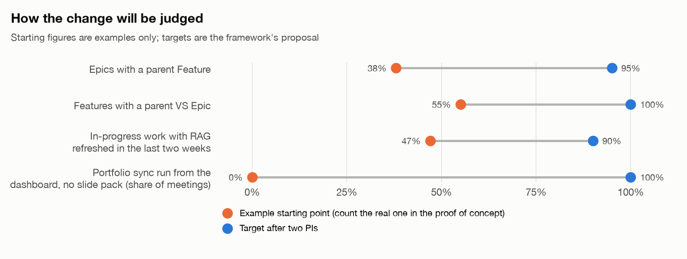

*Figure 1. Success measures for the project. Starting points are examples; targets are proposals.* **Hosted in: Confluence.**

| Measure | Target after two PIs |
| --- | --- |
| Epics with a parent Feature | Above 95% |
| Features with a parent VS Epic | 100% |
| In-progress Features and Epics with RAG refreshed in the last two weeks | Above 90% |
| Portfolio sync run from the dashboard with no separate slide pack | Yes |
| Time spent each month assembling status reports | Halved |
| Cross-application dependencies found at planning, not during the PI | Rising |
| Teams saying the weekly update takes under ten minutes | Most |

## 3. Design principles and constraints

### Principles

1. **One line, top-down.** Every ticket can be reached from a VS Epic. Views start at the value stream and go down; nothing is reported from the bottom up by hand.
2. **Use what exists.** Existing issue types, statuses and fields only. Central administration makes new ones slow to get, and they would have to be migrated to Cloud.
3. **One meaning per field.** Each field answers one question and has one named person who keeps it right. That is what makes a filter reliable.
4. **The ticket is the status report.** Meetings are run from boards and dashboards, and tickets are updated in the room.
5. **A promise is recorded once and not edited.** What was committed at PI planning is kept as a baseline, so what happened can be compared with it.
6. **Judgement stays with people.** RAG is the owner's judgement, not a calculation. Gates are checked by people until the administrator can enforce them.
7. **Measure a group against its own past.** Story points and predictability are never used to rank teams against each other.
8. **Small upkeep.** Daily updates belong to stories. Nothing at Epic level or above needs a daily update unless something changed that day.
9. **Two places to look.** Jira dashboards for live lists, Confluence for everything rolled up. Nobody has to learn Plans to read the portfolio.

### Constraints the design works within

| Constraint | Consequence in the design |
| --- | --- |
| Jira Data Center today; Jira Cloud next year | Built on standard fields and links, not scripts. Section 17 lists what survives the move and what is redone. |
| On today's Data Center the two top issue types are named **Capability** and **Initiative**, and there is no Milestone issue type yet | This paper uses the names from the Cloud standards: VS Epic and Feature. Until the move, read VS Epic as Capability and Feature as Initiative. A Milestone is a Task with the labels `milestone` and `ms-...` until the Milestone type exists; its slippage cannot be measured until then. |
| Jira administration is central | No new fields or statuses. Eight requests to the administrator, none structural. |
| No ScriptRunner | No scripted queries or calculated fields. A few standard automation rules instead. |
| Plans (Advanced Roadmaps) is available, but few people use it because its views are hard to read | Plans is used for one thing people look at: the L0 roadmap. It also provides the Parent Link field, which is set on the ticket screen without opening a plan. The PI plan, capacity, dependencies and progress roll-ups are Confluence pages. |
| Each application has its own project | The application is read from the project. Component is free for modules. |
| Confluence has Table Transformer and Chart from Table | Confluence is the main place to look: roll-ups, the PI plan, the dependency board, trends, and a page for each role. |
| A PI is 12 weeks | Five two-week sprints and one planning sprint. |

---

# Part B: The model

## 4. Structure: two layers, one join

*Figure 2. The hierarchy with a worked example. The Feature "M&P across the platform" is delivered by two applications; each has its own Epic under the same Feature. Delivery RAID tickets are kept in the portfolio project and linked to the work they affect at any level: here one to a Feature and one to an Epic.* **Hosted in: Diagram.**

**Portfolio layer: one Jira project for the whole value stream.** It holds only VS Epics, Features, Milestones and Delivery RAID. No team does sprint work here.

**Team layer: one Jira project per application.** Each holds Epics, Stories, Tasks, Bugs, Tests and Sub-tasks.

**The join is the Feature.** It lives in the portfolio project and is the parent of one Epic in each application that must change to deliver it.

### The levels

| Level | Issue type | Lives in | What it is | Size | Owner |
| --- | --- | --- | --- | --- | --- |
| 1 | VS Epic | Portfolio project | A business outcome for the value stream, usually crossing sub value streams | 2 to 4 PIs | Value stream lead |
| 2 | Feature | Portfolio project | A slice of a VS Epic that one sub value stream can deliver and show to users. May need several applications. | One PI; two only when planned that way and agreed | Product lead |
| 3 | Epic | Application project | One application's share of a Feature | 1 to 5 sprints | Application product owner |
| 4 | Story, Task, Bug, Test | Application project | A piece of work one team finishes in a sprint | Under one sprint | Team |
| 5 | Sub-task | Application project | A step inside a story. Optional. | Days | Individual |
| Side | Milestone | Portfolio project | A date that matters: regulatory deadline, go-live, PI boundary | A date | Delivery lead |
| Side | Delivery RAID | Portfolio project | A risk, assumption, issue or dependency that needs managing above team level | Until closed | Delivery lead |

### The worked example

| Level | Ticket | Where | Named as |
| --- | --- | --- | --- |
| VS Epic | Avoid audit risk through access control | Portfolio project | An outcome: what gets better, for whom |
| Feature | M&P across the platform | Portfolio project | A capability, with no application name in it |
| Epic | M&P for Credit Application | Credit Application project | The capability plus the application |
| Epic | M&P for Drawdowns | Drawdowns project | The capability plus the application |

### Six rules that keep the structure honest

1. **Every Epic has a parent Feature.** An Epic with no parent is invisible to the portfolio, appears on an exceptions list, and is not planned into a PI.
2. **Every Feature has a parent VS Epic.** Upkeep goes under one standing Feature per sub value stream per year, "Run and improve". That Feature has no Target PI and no commitment label, is left out of predictability, and is closed at year end.
3. **A Feature belongs to exactly one sub value stream:** the one accountable for the result. Its Epics may sit in any application, including one owned by another sub value stream.
4. **A Feature is never split by application.** The application split is the Epic's job.
5. **Stories never sit in the portfolio project, and Features never sit in an application project.**
6. **Nobody creates work in another team's project.** A team that needs something from another team raises an ask in the portfolio project; the team that will do the work creates its own ticket (section 12).

### How ticket types relate

Parent relationships are strict: one parent only. Everything else is a link, and links can be many to many.

| From | To | How many | Recorded as |
| --- | --- | --- | --- |
| VS Epic | Feature | One VS Epic has many Features. A Feature has one VS Epic. | Parent Link on the Feature |
| Feature | Epic | One Feature has many Epics, often in different applications. An Epic has one Feature. | Parent Link on the Epic |
| Epic | Story, Task, Bug, Test | One Epic has many. Each has one Epic. | Epic Link |
| Story | Sub-task | One Story has many. | Built-in parent |
| VS Epic | Milestone | Many to many. A VS Epic usually has several Milestones; one regulatory date can serve several VS Epics. | blocks link (VS Epic blocks Milestone) |
| Feature | Milestone | Many to many. A go-live waits for several Features; a Feature can serve a pilot date and a full launch. | blocks link (Feature blocks Milestone) |
| Delivery RAID | Epic, Feature, VS Epic, Milestone | Many to many. Linked at the level where the impact is felt. | relates to link |
| Feature | Feature | Many to many | blocks link |
| Epic | Epic | Many to many, usually across applications | blocks link |
| Feature | Sub value stream | Many Features to one sub value stream | Value Stream and Sub-Value Stream field |
| Feature | Program Increment | Many Features to one PI | Target PI field |
| Epic, Story, Bug | Release | Many to one release | Fix version in the application project |
| Feature | Application | Many to many | Read from the child Epics' projects |

Two guards keep the many-to-many links readable. Link a Milestone at the highest level that is true: to the VS Epic if the whole outcome is due, to specific Features if only they are. And when one Feature seems to need two parents, it is two Features.

### Stitching: joining what already exists

Each application product owner already has a list of Epics for next year. Nobody re-enters anything. The lists are joined upward in seven steps.

| # | Step | Who | Result |
| --- | --- | --- | --- |
| 1 | **List.** Every wanted Epic exists in its application project in Idea or Analysis, with a one-line purpose, a rough size and a hoped-for quarter. | Product owners | A complete starting list |
| 2 | **Cluster.** In one working session per sub value stream, group Epics that deliver the same capability in different applications. Each group becomes a Feature, and the Epics get it as Parent Link. | Product lead, product owners | Features with Epics beneath them |
| 3 | **Lift.** Group Features by the outcome they serve. Each group becomes a VS Epic. | Value stream lead, product leads | The cross-stream picture |
| 4 | **Place the leftovers.** An Epic that shares a capability with nobody gets a Feature of its own if users will notice it, or goes under "Run and improve" if it is upkeep. | Product lead | No orphan Epics |
| 5 | **Look down from the top.** For each Feature, ask which applications must change. Where one has no Epic, add a placeholder or mark the Feature as partial. | Product lead | Gaps found before planning |
| 6 | **Spot clashes.** Two applications building the same thing differently become a Delivery RAID issue or a blocks link. | Delivery lead | Clashes on record |
| 7 | **Check.** The hygiene filter returns nothing, every Feature has a VS Epic, every VS Epic has an owner. | Framework owner | Stitching complete |

What this produces is the candidate backlog for the year: every Epic reachable from a VS Epic. It is not yet a plan. Sequencing and Target PI come from PI planning.

## 5. Fields, labels and links

### The connecting fields

| Question it answers | Field | On which tickets | Rule |
| --- | --- | --- | --- |
| Which sub value stream? | Value Stream and Sub-Value Stream | VS Epic, Feature, Epic, Milestone, Delivery RAID, Bug, Test | An Epic takes the value of its parent Feature, even when it sits in another sub value stream's application |
| Which application? | Project | Epic and below | The project itself |
| Which module? | Component | Epic and below | One component per module |
| Which PI was it planned for? | Target PI | Feature, Epic | Set at PI planning. Not changed afterwards for committed work. |
| Which PI did it finish in? | Actual PI | Feature, Epic | Set by automation when the ticket reaches Released |
| Which production release? | Fix versions | Epic, Story, Bug | One version per release in each application project |
| Which team? | Team | Epic, Story, Task, Bug | One value per application team |
| What kind of work? | Enabler Type; Regulatory or Control Change Type | Feature | Set at triage. Drives the investment mix. |
| How is it going? | RAG Status, Path to Green, Date to Green, Executive Summary | VS Epic, Feature, Milestone, Delivery RAID. Epic: RAG Status only (see the open point below) | Reviewed weekly by the owner |
| What comes first? | The four scoring fields and Weighted Shortest Job First Score, then Rank | VS Epic, Feature | Scored in Analysis |
| When is it due? | Due date; Start date and End Date for the roadmap and the PI plan page | All | Due date is the date people outside the team are told |

### RAG: one meaning for each colour, at every level

| Colour | Means | Owner must also |
| --- | --- | --- |
| **Green** | On track for its date. No help needed. | Nothing |
| **Amber** | The date is at risk and the owner has a recovery plan | Fill in Path to Green and Date to Green |
| **Red** | The date will be missed unless someone outside the team decides or acts | Say what is needed and from whom; on a Feature, set Management Attention |

A parent is never greener than the facts beneath it: a Feature with a Red Epic is at least Amber. A RAG nobody has touched for two weeks is treated as unknown. Raising Amber early is the right thing to do; staying Green until the last week is what the rule exists to stop.

### Labels: four small groups, and no others

| Label | Used on | Meaning | Set by |
| --- | --- | --- | --- |
| `pi-committed` or `pi-stretch` | Feature, and each of its Epics | Firm commitment for the Target PI, or a stretch goal | Product owner on the Epic, product lead on the Feature, at PI planning only |
| `unplanned` | Feature, Epic | Entered a PI after planning closed, by decision | Delivery lead |
| `pi-descoped` | Feature, Epic | Taken out of a PI after planning closed, by decision | Delivery lead |
| `ms-regulatory`, `ms-golive`, `ms-pi`, `ms-external` | Milestone | The kind of Milestone | Delivery lead |

### Links: three types only

| Link | Use |
| --- | --- |
| **blocks / is blocked by** | A real dependency between two Features or two Epics. The ticket that must finish first blocks the other. |
| **relates to** | Ties a Delivery RAID ticket to the work it concerns: an Epic, a Feature, a VS Epic or a Milestone |
| **duplicates** | Closes repeat requests at intake |

### The field shortlist

Each issue type offers between about 18 and 60 fields on its screen. The framework reads only a shortlist. Core fields are always filled in; the others only when the situation applies. Any field not on the shortlist is left as the organisation's standards require and is read by no filter, dashboard or report here.

*Figure 3. Fields the framework uses, against fields offered on the screen. Screen totals are approximate.* **Hosted in: Confluence.**

| Issue type | Core fields (always) | Only when it applies | Set by Jira or automation |
| --- | --- | --- | --- |
| **VS Epic** (16) | Summary, Description, Assignee, Value Stream and Sub-Value Stream, Objective ID, Business Benefits, the four scores, Start date, End Date, Due date, RAG Status, Executive Summary, Linked work items | Path to Green, Date to Green, Financial Benefit (USD), Regulatory or Control ID, Change Reason, Flagged | Weighted Shortest Job First Score |
| **Feature** (17) | Summary, Description, Assignee, Parent Link, Value Stream and Sub-Value Stream, Enabler Type, Acceptance Criteria, Business Benefits, T-Shirt Size, the four scores, Target PI, Labels, Due date, RAG Status | Start date, End Date, Path to Green, Date to Green, Management Attention, Executive Summary, Regulatory or Control Change Type, Regulatory or Control ID, Architectural Governance, Contains Resiliency Work, Change Reason, Linked work items, Flagged | Actual PI, Weighted Shortest Job First Score |
| **Epic** (14) | Summary, Epic Name, Description, Assignee, Parent Link, Components, Team, Story Points, Target PI, Labels, End Date, RAG Status, Fix versions, Linked work items | Start date, Change Request ID, Regulatory or Control Change Type, Flagged | Actual PI, Value Stream and Sub-Value Stream |
| **Story** (8) | Summary, Description, Epic Link, Acceptance Criteria, Story Points, Assignee, Sprint, Components | Fix versions, Story Type, Flagged | Status, Resolution |
| **Task** (6) | Summary, Description, Epic Link, Assignee, Sprint, Story Points | Acceptance Criteria, Flagged | Status, Resolution |
| **Sub-task** (3) | Summary, Assignee, Parent | Flagged | Status |
| **Bug** (11) | Summary, Description, Epic Link, Severity, Priority, Testing Phase, Environment, Affects versions, Assignee, Sprint, Components | Fix versions, Root cause category, Root cause analysis, Flagged | Status, Resolution |
| **Test** (7) | Summary, Description, Epic Link, Testing Phase, Environments, Assignee, Sprint | Fix versions | Status, Resolution |
| **Milestone** (9) | Summary, Description, Assignee, Value Stream and Sub-Value Stream, Due date, Baseline End Date, RAG Status, Labels, Linked work items | Path to Green, Date to Green, Executive Summary, Regulatory or Control ID, Fix versions | |
| **Delivery RAID** (10) | Summary, Description, RAID Type, Assignee, Value Stream and Sub-Value Stream, Components, RAG Status, Due date, Impact, Linked work items | Risk: Probability, Risk Trigger Event, ROAM Response. Dependency: Dependency Type, Supplier Value Stream and Sub Value Stream, Baseline End Date. Issue: Impact Details, Path to Green, Date to Green. | |

**An open point on Epic.** From the standards page, Epic does not appear to carry Path to Green, Date to Green or Due date. Until that is confirmed or the fields are added, an Epic's expected go-live date is its End Date, and the recovery plan for an Amber or Red Epic is a comment starting "Path to green:". This is decision 7 in section 20.

**Two rules keep the list short.** A field joins the shortlist only when a filter, dashboard, report or decision reads it. And when one is added, another is reviewed for removal.

## 6. Workflows and gates

The existing statuses are enough. What is missing today is a shared meaning for each one and a rule for entering it.

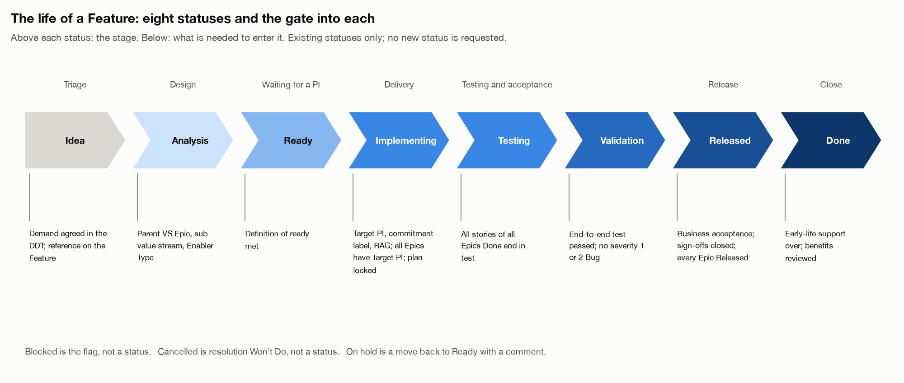

*Figure 4. The life of a Feature. The same pattern, with fewer statuses, applies to VS Epics and Epics.* **Hosted in: Diagram.**

### VS Epic

| Status | Meaning | To enter it |
| --- | --- | --- |
| Idea | Someone has raised it. No commitment. | Summary, sponsor and the problem in two sentences |
| Review | The portfolio sync is deciding whether it is worth analysing | Triage owner assigned |
| Analysis | A named lead is shaping it: outcome, measure of success, sub value streams involved, rough size | Accepted at the portfolio sync |
| Ready | Approved to start. Split into Features for at least the next PI. | Outcome and success measure written, first Features created, sponsor sign-off |
| Implementing | At least one Feature is being built | First child Feature moves to Implementing |
| Released | Every planned Feature is live in production | All child Features Released or Done |
| Done | The outcome has been checked against the success measure | Benefit review recorded |

### Feature

| Status | Meaning | To enter it |
| --- | --- | --- |
| Idea | Raised, not yet triaged | Intake details filled in |
| Analysis | Product lead is writing acceptance criteria, naming the applications and agreeing the design | Parent VS Epic, sub value stream and Enabler Type set |
| Ready | Can be pulled into a PI | Definition of ready met (section 7) |
| Implementing | At least one child Epic is in progress | Target PI, commitment label and RAG Status set |
| Testing | All child Epics are built. End-to-end testing across applications is running. | Every story in every child Epic is Done and deployed to test |
| Validation | Business users are confirming it does what was asked | End-to-end test passed, no open severity 1 or 2 bug |
| Released | Live in production | Business sign-off recorded, change record linked, every child Epic Released, Done or closed as Won't Do |
| Done | Early-life support closed | Support period over with no open critical bug |

### Epic

| Status | Meaning | To enter it |
| --- | --- | --- |
| Idea | Placeholder created during Feature analysis | Parent Feature set |
| Analysis | Team is breaking it into stories and estimating | Product owner assigned |
| Ready | Stories for the first two sprints are written and estimated | Estimate recorded, dependencies linked |
| Implementing | Stories are being built or tested, or are finished and waiting for go-live | Sprint work started |
| Released | Live in production | Fix version set and released, Change Request ID set |
| Done | Nothing left, including clean-up | All child issues closed |

### Story, Task, Bug, Test, Delivery RAID, Milestone: Backlog, In Progress, Done

| Type | Backlog means | In Progress means | Done means |
| --- | --- | --- | --- |
| Story, Task, Bug, Test | Not started | Being worked on in a sprint | Meets the team's definition of done |
| Delivery RAID | Raised, owner not yet acting | Owner is actively managing it | Closed: mitigated, accepted, resolved or no longer relevant |
| Milestone | Date agreed, not started | Work towards it is under way | Date met, with the actual date in a comment |

### Four conventions that avoid new statuses

| Need | Convention |
| --- | --- |
| Blocked | The Jira flag, not a status. A flagged card turns yellow and can be filtered. |
| Cancelled | A resolution, not a status: Done with resolution "Won't Do". Only resolution "Done" counts as delivered. |
| On hold | A move back to Ready with a comment |
| A review or test step for stories | One optional extra status, "In Review", and only if teams need it |

### Definition of done at each level

| Level | Done means |
| --- | --- |
| Story | Acceptance criteria met, code reviewed, automated tests pass, tested in the team environment, no open severity 1 or 2 defect |
| Epic (to Released) | All stories Done; integration and regression tests passed; non-functional needs met or a waiver recorded; Fix version and Change Request ID set; support notes handed over |
| Feature (to Released) | Every Epic Released; end-to-end test across applications passed; business acceptance recorded; sign-offs closed; no open severity 1 or 2 defect |
| Feature (to Done) | Early-life support closed; Business Benefits reviewed against what was expected |
| VS Epic (to Done) | Outcome measured against its success measure and recorded |

---

# Part C: How work flows

## 7. Intake and design

### One front door for new demand

New demand has one front door: a request in the **demand intake project in Jira Service Management**. It is used for nothing else. Next year's existing Epic lists do not go through it; they are stitched (section 4). Delivery is never tracked there.

Requests are decided at the **DDT**, the advisory board forum that reviews new demand. The two fit together: the demand intake project is where a request is recorded and followed, and the DDT is where it is decided. The DDT works from the intake queue on screen and records each decision on the request in the meeting, so there is no separate list.

### Why a request and a Feature are two tickets

Starting in the demand intake project and continuing in the portfolio project means one piece of demand has two tickets. That is deliberate, and it is the better design, on one condition: nothing is typed twice.

| | The request | The Feature |
| --- | --- | --- |
| Belongs to | The requester | The product lead |
| Says | What was asked for, and why | What will be built, across which applications |
| Ends when | A decision is made and the requester has been told the outcome | The capability is live and its benefit looked at |
| Lives in | Demand intake project (Jira Service Management) | Portfolio project |
| Seen by | Requesters, through the portal, without access to the delivery projects | Teams, product owners, delivery leads, sponsors |

| With one ticket for both | With two linked tickets |
| --- | --- |
| A declined request stays in the delivery backlog as a dead Feature | A declined request is closed where it was raised |
| One request that needs three Features, or three requests that are one Feature, cannot be represented | One request links to several Features; several requests link to one |
| The requester needs access to the portfolio project to follow it | The requester follows the request in the portal |
| Intake age and delivery progress are mixed in one status | Each ticket has a status that means one thing |
| The Idea column fills with unscreened demand | Only approved demand reaches the Idea column |

**What removes the cost of two tickets.** On approval, automation creates the Feature from the request, copies the summary, description and sponsor, and links the two. When the Feature is released, automation comments on the request and closes it. Until that automation exists, the product lead uses "Create linked issue" on the approved request, which copies the text and links the tickets in one step.

### From a request to a Feature in Idea

| # | Step | Who | In Jira | By when |
| --- | --- | --- | --- | --- |
| 1 | **Raise** | Anyone with a need | A request through the portal form | Any time; the cut-off for the next PI is week 7 |
| 2 | **Screen** | Intake owner, in the platform team | Checks the form is complete; looks for a duplicate; routes it (table below); assigns it to the product lead of the accountable sub value stream | Within 5 working days |
| 3 | **Assess** | Product lead, with the product owners likely to be involved | Adds the VS Epic it would serve, a T-Shirt Size, the applications likely to change and a proposed PI | Within 10 working days of screening |
| 4 | **Decide** | The DDT, from the intake queue | Approve, decline, park or merge, recorded as the approval on the request with a one-line reason | At the next DDT after assessment |
| 5 | **Hand over** | Automation, then the product lead | A Feature is created in the portfolio project in status Idea, linked to the request. The requester is notified. | The same day |
| 6 | **Close the loop** | Automation | When the Feature reaches Released, the request is commented on and closed | At release |

The request form asks for: the problem and for whom; what should be true when it is solved; the sponsor; any fixed date and where it comes from; what happens if it is not done; the users affected; whether it is regulatory, audit or control related; and anything already known.

### Routing at screening

Not everything needs a Feature.

| The request is | Route |
| --- | --- |
| A defect or a production problem | The incident tool, or a Bug in the application project |
| A small change to one application, about a sprint or less | Straight to that application's product owner, as a Story or Epic under "Run and improve" |
| A new capability, one PI or less, in one or more applications | Assessment, then a Feature |
| An outcome larger than one PI, or across sub value streams | Assessment, then a VS Epic created by the value stream lead, with Features to follow |
| Regulatory, audit or control work with a fixed date | Fast path: assessed within 5 working days; a Feature plus a Milestone |
| A duplicate | Linked to the earlier request and closed |

The Idea status in the portfolio project is therefore not a second front door. Only two things arrive there: candidate Features created during stitching, and Features created from approved requests. A proposed PI on a request is a proposal: it becomes Target PI only at PI planning.

### Who creates which ticket

| Ticket | Created by | Where |
| --- | --- | --- |
| Request | Anyone with a need, through the portal | Demand intake project |
| Feature | Automation, from an approved request; owned from then on by the product lead. During stitching, the product lead. | Portfolio project |
| VS Epic | Value stream lead | Portfolio project |
| Epic | The product owner of the application that will do the work; never the requester, and never someone from another team | That application's project |
| Story, Task, Test | The team | Application project |
| Bug | Whoever finds it | Application project |
| Delivery RAID | Product owner, scrum master, delivery lead or product lead | Portfolio project |
| Milestone, release version | Delivery lead | Portfolio project; each application project |

### From a Feature in Idea to a Ready Feature

| Step | What happens | In Jira |
| --- | --- | --- |
| 1. Triage, weekly | The product lead decides when there is capacity to shape it | Sets sub value stream, Enabler Type and parent VS Epic; moves the Feature to Analysis, or closes it as a duplicate or Won't Do |
| 2. Analyse and design | Scope, design and the application split are worked out | Acceptance Criteria and Business Benefits; design page linked; sign-off tasks raised; each application's product owner creates an Epic with an estimate; blocks links inside the Feature; asks raised for work from outside it (section 12) |
| 3. Score and rank | The sub value stream scores its Features together | The four scores filled in; the Feature placed in order on the board |

### Definition of ready for a Feature

A Feature moves to Ready only when all of these are true:

- [ ] Parent VS Epic, sub value stream and Enabler Type are set.
- [ ] Acceptance Criteria and Business Benefits are filled in and agreed with the sponsor. T-Shirt Size and the four scores are filled in. (A regulatory Feature with a fixed date needs its Milestone and Regulatory or Control ID instead of scores.)
- [ ] Every application that must change has a child Epic, and each Epic has a rough size.
- [ ] Design is linked, with any architecture, risk or control approvals required.
- [ ] Dependencies are linked, and outside dependencies have a RAID ticket with an owner.
- [ ] It fits in one PI, or it is an agreed two-PI Feature. Otherwise it is split.

### Unplanned work

An urgent request after PI planning has closed still comes through the front door. It enters the PI only by a decision of the product lead and delivery lead together (the value stream lead if it touches more than one sub value stream), and the decision names what moves out. What comes in gets Target PI and the `unplanned` label; what goes out gets `pi-descoped`. Production incidents stay in the incident tool; the fix becomes a Bug carrying the incident reference.

## 8. Roadmap, sizing and prioritisation

### Three levels of plan

| Level | Horizon | Grain | Dated by | Owner | View |
| --- | --- | --- | --- | --- | --- |
| **L0 roadmap** | 12 to 18 months | VS Epics, with Features as bars inside them, and Milestones | PI or quarter | Value stream lead | Plans view "L0 roadmap", shown on a Confluence page |
| **L1 PI plan** | One PI, 12 weeks | Features and Epics | Sprint | Product and delivery leads | Confluence page "PI plan" |
| **L2 sprint plan** | Two weeks | Stories | Day | Team | Team board |

### The L0 roadmap

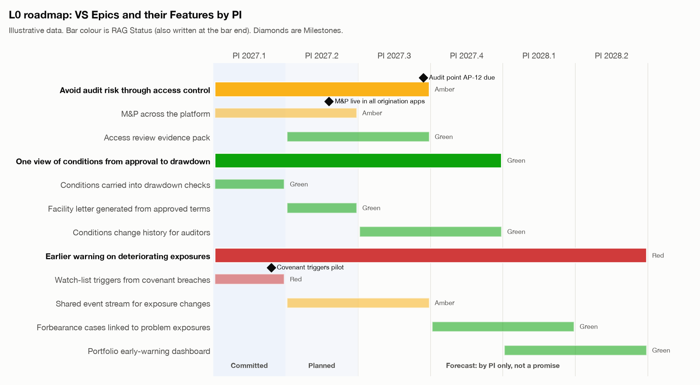

*Figure 5. The L0 roadmap. This is the one view kept in Plans; it reads the same tickets as every other page, so it cannot drift from them.* **Hosted in: Plans.**

How it is built:

1. After stitching, every VS Epic and Feature gets a Start date and End Date at PI precision: the first day of the PI it should start in and the last day of the PI it should end in. Nothing finer.
2. In Plans, one plan is created for the value stream and a view named "L0 roadmap" is saved: hierarchy from VS Epic to Feature only, timeline in quarters, coloured by RAG Status, with Milestones shown by Due date.
3. Confidence is marked by distance. The current PI is committed. The next PI is planned. Anything later is a forecast shown by PI only. A roadmap without this marking is read as a promise.
4. It is reviewed at the fortnightly portfolio sync and re-issued after every PI planning.
5. The view is shared on a Confluence page, so readers do not open Plans. If sharing is not allowed, the same roadmap is drawn on Confluence as a Gantt chart from VS Epics and Features with their dates.

### Sizing a VS Epic

The size firms up in three stages, and the roadmap says which stage a number is at.

| Stage | When | Source of the number | Accuracy |
| --- | --- | --- | --- |
| 1. Rough | Stitching, or assessment of a request | T-Shirt Size on each Feature, turned into points with one conversion table calibrated from finished Features | Within a factor of two |
| 2. Planned | Feature in Analysis | Story Points on each Epic, given by the team that will build it | Good enough to commit a PI |
| 3. Detailed | Epic in Implementing | Sum of Story Points on its stories | Good enough to forecast a date |

### Prioritising: Weighted Shortest Job First

Features and VS Epics already carry four scores: User/Business Value, Time Criticality, Risk Reduction / Opportunity Enablement, and Job Size. The first three are added and divided by job size. A higher score goes first.

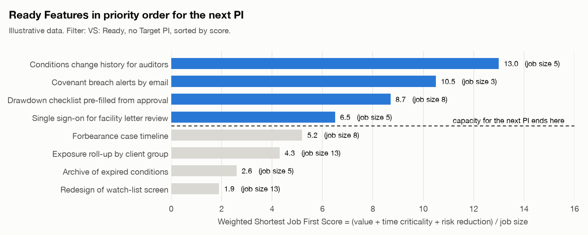

*Figure 6. Ready Features in score order. The list above the line is the proposal for the next PI.* **Hosted in: Jira.**

Two rules make scores comparable: each sub value stream scores its Features together in one session, against each other; and scores use one short scale (1, 2, 3, 5, 8, 13, 20). Regulatory work with a fixed date is not argued through the score: it gets a Milestone, and the date decides.

## 9. PI planning

Planning a PI means deciding which Ready Features, and which of their Epics, get that PI in the Target PI field.

*Figure 7. The PI calendar, with the Jira actions that fall on fixed days.* **Hosted in: Diagram.**

### Before (weeks 7 to 10 of the current PI)

| Week | Must be true | In Jira |
| --- | --- | --- |
| 7 | Features proposed for the next PI are at least in Analysis; new demand for that PI has closed | |
| 8 | Every ask to another team for the next PI has been raised | Delivery RAID Dependency tickets, status Backlog |
| 9 | Proposed Features are Ready | Delivery lead creates the two per-PI filters. Product leads set Target PI on proposed Features (the draft). |
| 10 | Each team's capacity is known; every ask has an answer; dependencies are linked | Capacity typed into the capacity table on the PI plan page; sprints created and named; agreed dependency tickets In Progress, with a blocks link between the two Epics |

A Feature that is not Ready by week 9 does not enter planning.

### During (two days)

1. Carried-over work is placed first.
2. Each product owner sets Target PI and End Date on the Epics the team can take, on the Epic itself or by bulk edit. Stories are placed into sprints on the team board, up to capacity.
3. For each Feature, the product lead checks on the PI plan page that every child Epic, in every application, has the Target PI. If one application cannot take its share, the Feature is moved, cut down, or planned over two PIs on purpose.
4. At the end of day 1 the delivery leads walk the dependency list: asks not agreed, date conflicts, and anything found in the room. Conflicts are settled on day 2. Anything still unresolved is a Delivery RAID ticket with an owner before the day ends.
5. Each Epic that stays, then each Feature, gets `pi-committed` or `pi-stretch`, a date, and RAG Status Green. An Epic that waits on an unagreed dependency is stretch, not committed (the lock rule in section 12).
6. A confidence vote is taken and recorded on the planning Milestone.

*Figure 8. Load against capacity. The Drawdowns team is over capacity before stretch work is counted, which is settled in the room, not discovered in week 10.* **Hosted in: Confluence.**

### What goes into a PI plan, in this order

1. Spillover from the PI that is ending. It uses capacity before anything new.
2. Epics tied to a regulatory or go-live Milestone that falls in or just after the PI.
3. Committed Features by score, each with all of its Epics.
4. Stretch Features, clearly labelled.

### Commitment is made twice

Each product owner commits the Epic for their application. The product lead commits the Feature only when every one of its Epics is committed. Both are measured, so one late application is visible without marking down the others.

### The lock, and the baseline

| Must be true to close planning | In Jira |
| --- | --- |
| Every committed Feature has all its Epics committed | Label and Target PI on each |
| Every team's load is within capacity | Capacity table on the PI plan page |
| Every dependency has both ends planned, giver before receiver | Dependency board on the PI plan page: no negative or unknown margin |
| No committed Epic waits on an unagreed dependency | The "not agreed" list on the dependency dashboard, read at the lock |
| Risks raised in the room have an owner and a response | Delivery RAID tickets |
| Confidence vote taken | Comment on the planning Milestone |
| The delivery lead announces the lock | Committed list pasted into the PI scorecard page as a plain table |

**That pasted table is the baseline.** It is the only list predictability is counted from, and nobody edits it afterwards. After the lock, Target PI and the commitment labels change only by decision.

### What is touched in Jira at each PI

Filters are live: a saved filter is a question Jira answers again each time it is opened. When a product owner sets Target PI on an Epic, it appears in the PI filters, dashboards and Confluence pages straight away. Nothing is rebuilt. Four small edits are made per PI.

| When | What | Who |
| --- | --- | --- |
| Week 9, when drafting begins | Create two filters: `PI <next> planned Features` and `PI <next> planned Epics` | Delivery lead |
| The day planning closes | Paste the committed list into the new PI scorecard page | Delivery lead |
| Day 1 of the new PI | Repoint `VS: PI planned Features` and the first part of `VS: PI Epics` to the new PI's filters | Delivery lead |
| Day 1 of the new PI | Add the ended PI to the list in `VS: spillover`; change the PI value in automation rule 4 and the board quick filter | Delivery lead |

Old per-PI filters are kept and never edited, because old scorecards read them.

### Where PI planning is done, and where it is seen

Planning changes are made on the tickets. The plan is read on one Confluence page. Nobody needs to open Plans to plan a PI.

| Activity | Where it is done | Where it is seen |
| --- | --- | --- |
| Decide what goes into the PI | Target PI and End Date on each Epic and Feature, on the ticket or by bulk edit | PI plan page: Epics by application and sprint |
| Load the sprints | Team board, backlog view | Team board |
| Check load against capacity | Capacity per team typed into one small table on the PI plan page | PI plan page: story points planned against capacity, per application (figure 8) |
| Find and settle dependencies | Dependency tickets and blocks links (section 12) | PI plan page: the dependency board, with the margin between need-by and promised dates |
| Commit | Labels on Epics and Features | PI plan page; then the baseline pasted into the PI scorecard |
| See the year | Start date and End Date on VS Epics and Features | The L0 roadmap, the one view kept in Plans |

**The PI plan page in Confluence** has four parts, each a Jira Issues macro wrapped in Table Transformer:

1. Features of the PI, with their Epics counted by application and status.
2. Epics by application and sprint, the sprint worked out from each Epic's End Date.
3. Story points planned against capacity, per application.
4. The dependency board: one row per dependency ticket, with need-by date, promised date and margin.

The page is copied for each PI, and only the filter name inside it changes. Section 12 shows parts 2 and 4 (figure 17).

**What is given up by not planning in Plans.** There is no drag and drop on a timeline, and no automatic scheduling. Capacity is checked per PI on Confluence and per sprint on the team board, not in one combined view. The page shows changes when it is reloaded, not as they are typed. These are accepted in exchange for a view people will actually read.

## 10. Delivery control

Four questions matter most in delivery, and each has one field, link or label that answers it.

| Question | Answered by | Seen in |
| --- | --- | --- |
| What blocks what? | Delivery RAID Dependency tickets, and blocks links between Epics (section 12) | The dependency dashboard in Jira; the dependency board on the PI plan page |
| What is in the PI plan? | Target PI on the Epic and on the Feature | The PI plan page in Confluence; filter `VS: PI Epics` |
| What spilled over? | Target PI is an earlier PI and the ticket is not finished | Filter `VS: spillover` |
| What was delivered late or in part? | Actual PI compared with Target PI, Epic by Epic | Confluence: Feature progress across applications; the PI scorecard |

### Which application is a Feature waiting for?

*Figure 9. One row per Feature, one column per application. This view does not exist today; it is the main reason for the Feature-to-Epic join.* **Hosted in: Confluence.**

### Spillover

- **Definition.** A committed Epic or Feature whose Target PI has ended and which has not reached Released. Nobody declares it; the fields show it.
- **Target PI is not edited to hide it.** The ticket keeps its original Target PI and gets its Actual PI when it finishes. Even if someone did edit it, the baseline table still holds the promise.
- **Where it sits in the next PI.** The current-PI filters and the PI plan page include it automatically, and it takes capacity first.
- **Every spillover gets a reason** at the PI review: Dependency, Capacity, Scope, Defect or Environment.
- **Every spillover gets a decision:** carry on (the default), stop, or split.
- **Early warning during the PI:** committed Epics not started by week 5; Amber and Red RAG; blockers past their date.

### Planned for one PI, delivered by one application only

A worked case. Feature "M&P across the platform" is committed for PI 2027.4 with two committed Epics.

| Ticket | Target PI | At the end of PI 2027.4 | Actual PI | Scorecard result for PI 2027.4 |
| --- | --- | --- | --- | --- |
| Epic: M&P for Credit Application | PI 2027.4 | Released | PI 2027.4 | Delivered |
| Epic: M&P for Drawdowns | PI 2027.4 | Implementing | PI 2028.1, when it finishes | Spilled |
| Feature: M&P across the platform | PI 2027.4 | Implementing | PI 2028.1, when its last Epic finishes | Spilled, 1 of 2 Epics delivered |

What each person sees:

- Credit Application's Epic figure counts its Epic as delivered. That team is not marked down for another team's delay.
- Drawdowns shows one spilled Epic, with a reason.
- The Feature figure counts the Feature as spilled, and the view in figure 9 shows which application it is waiting for.
- In planning for PI 2028.1, the Drawdowns Epic is already in the current-PI views and takes capacity first.

Then one decision at the PI review. If the Credit Application part is useful to users by itself, the Feature may be split so the delivered part can be released. **A split never improves the score:** the baseline line for the original Feature stays "spilled". If nothing is usable until both applications are live, the Feature simply carries on.

### The PI scorecard and predictability

For every committed line in the baseline, the scorecard shows one of four results: delivered, spilled, descoped by decision, or stopped.

*Figure 10. The PI scorecard by application.* **Hosted in: Confluence.**

Three figures are reported side by side: committed Features delivered, committed Epics delivered, and the same weighted by story points. Stretch and unplanned results are listed beneath them, not hidden.

*Figure 11. Predictability across PIs. Around 80% is a healthy level to learn from, not a target; a figure that sits at 100% usually means too little was committed.* **Hosted in: Confluence.**

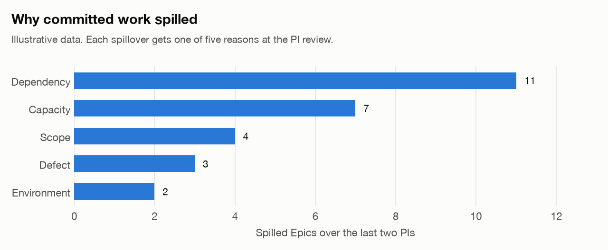

*Figure 12. Spillover reasons. Five words are enough to show a pattern after two PIs; here, dependencies would be the thing to fix first.* **Hosted in: Confluence.**

### Dependencies

How dependencies are raised, agreed, linked, shown in the PI plan and chased is set out in full in section 12. The matrix below is one of its views.

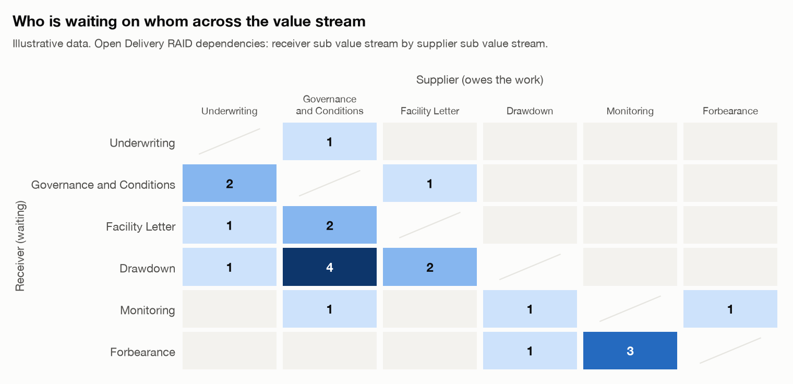

*Figure 13. Open dependencies, by receiver and supplier. Each side sees the same ticket from its own end: "what we are waiting for" and "what we owe".* **Hosted in: Confluence.**

## 11. Release planning

A release is a version in an application project. A PI is a planning window; a release is a production deployment; one PI usually holds several releases. They are kept apart on purpose.

### Naming

| Case | Version name | Example |
| --- | --- | --- |
| One application goes live alone | `<APP> <year>.<month>` | `DRAW 2027.03` |
| Several applications go live together | Same name created in each project | `CLP 2027.03` in three projects |
| Emergency fix | `<APP> <year>.<month> HF<n>` | `DRAW 2027.03 HF1` |

### Entering and leaving a release

| Stage | Must be true | In Jira |
| --- | --- | --- |
| Enter | The release is on the change calendar | Delivery lead creates the version in each application project, same name, with the go-live date |
| | Scope is known | Fix version set on the Epics, Stories and Bugs going in, during sprint planning |
| | Two sprints before go-live | Release gadgets reviewed weekly |
| | One sprint before go-live: scope cut-off | Anything not Done is moved to the next version; the product lead is told |
| | Go or no-go decided through the change process | Decision recorded on the go-live Milestone; change record number in Change Request ID on the Epics |
| Exit | Deployed to production | Delivery lead marks the version as released in each project |
| | | Product owners move Epics to Released. Automation fills in Actual PI. |
| | Every Epic of a Feature is Released, Done or closed as Won't Do | Product lead moves the Feature to Released |
| | Milestone met | Milestone moved to Done, with the actual date in a comment |

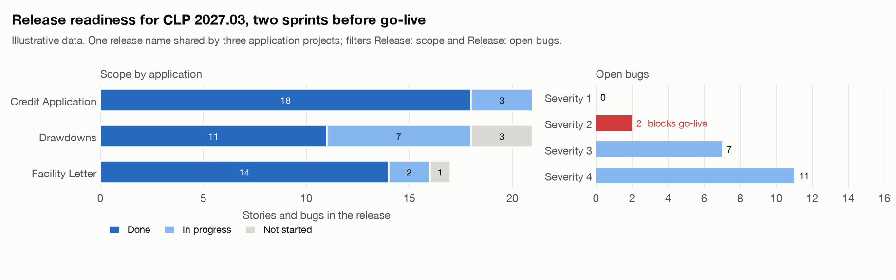

*Figure 14. Release readiness two sprints before go-live.* **Hosted in: Jira.**

**Two limits to know.** A released version in one project does not release the same-named version in another; each is marked. And version charts treat same-named versions in different projects as separate, so cross-application release views use filters on the shared name.

## 12. Dependencies, Delivery RAID and Milestones

Managing what teams need from each other is the largest single benefit of putting the value stream on one line. Today a dependency is discovered when a team stops. The aim of this section is that every dependency is **known before the PI is committed, owned by a named person, visible in the PI plan, and chased from one list.**

Three rules carry most of it:

1. **Nobody creates work in another team's project.** A team that needs something raises an ask on neutral ground. The team that will do the work creates its own ticket in its own backlog.
2. **An ask is not a promise.** A dependency is agreed only when the supplier has accepted it and planned it.
3. **No commitment on an unagreed dependency.** An Epic that waits on something not yet agreed is stretch, not committed.

### Five things that are often confused

| Thing | What it is | Where it lives | Who creates it | Example |
| --- | --- | --- | --- | --- |
| **Requirement** | The work itself: what must be built | An Epic or Story in the project of the team that will build it | That team's product owner | "Conditions API v2" in the Governance and Conditions project |
| **Dependency** | The relationship between two pieces of work, or between work and an outside party: who needs what from whom, by when | A **blocks** link between the two tickets, plus a Delivery RAID ticket of type Dependency when it needs managing | The team that is waiting | "Drawdowns needs Conditions API v2 before sprint 3" |
| **Risk** | Something that may go wrong | Delivery RAID, type Risk | Whoever sees it | "Drawdowns loses two engineers in February" |
| **Issue** | Something that has gone wrong and needs help from outside the team | Delivery RAID, type Issue | Whoever is affected | "Covenant feed test environment is not available" |
| **Blocker** | Work is stopped right now | The flag on the stopped ticket | The person who is stopped | A flagged story |

**Requirement or RAID?** The requirement is the content: it says what to build, and it belongs to the team that builds it. The dependency ticket is the wrapper: it says who is waiting, for what, by when, and whether it has been agreed. The requester never writes the supplier's backlog; the requester states the need, and the supplier turns it into their own Epic or Story.

### Three cases of "we need something from another team"

| Case | What to do | RAID ticket? |
| --- | --- | --- |
| **A. Another application's share of the same Feature.** The Feature needs Credit Application and Drawdowns to change. | During Feature analysis, the product lead asks each application's product owner to create their Epic under the Feature. If one must finish first, the two Epics are joined with **blocks**. | No, unless it is not agreed, or its date is at risk |
| **B. Work from a team outside the Feature:** another sub value stream, a shared service, a platform team in Jira. | The waiting product owner raises a Delivery RAID Dependency in the portfolio project, addressed to the supplier. The supplier accepts by creating or naming their own ticket and linking it (figure 16). | Yes, always |
| **C. Something from outside the value stream or outside Jira:** another division, a vendor, an environment, a decision. | The waiting product owner raises a Delivery RAID Dependency. The delivery lead names one person inside the value stream who chases it. The supplier's own reference goes in the description. | Yes, always |

Case A is the Feature-to-Epic join doing its normal job, which is why most dependencies inside a Feature need no RAID ticket at all.

### From a blocked story to a managed dependency

A team that is blocked during development should be able to raise the problem at its own level, and that is allowed: a Delivery RAID ticket may be linked to an Epic. The ladder below says when each step is used.

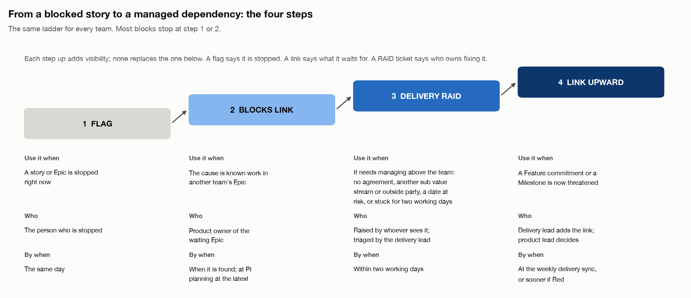

*Figure 15. The four steps. Each one adds visibility to the one below; none replaces it.* **Hosted in: Diagram.**

| Step | Use it when | Who | By when |
| --- | --- | --- | --- |
| 1. Flag | A story or Epic is stopped right now | The person who is stopped | The same day; removed the day it clears |
| 2. Blocks link | The cause is known work in another team's Epic | Product owner of the waiting Epic | When found; at PI planning at the latest |
| 3. Delivery RAID | It needs managing above the team: there is no agreement, it involves another sub value stream or an outside party, a date is at risk, or the flag has been on for two working days | Raised by the product owner or scrum master; triaged by the delivery lead | Within two working days |
| 4. Link upward | A Feature's commitment or a Milestone is now threatened | The delivery lead adds a link from the RAID ticket to the Feature or Milestone; the product lead decides what gives | At the weekly delivery sync, or the same day if Red |

### How a dependency is raised, agreed and linked

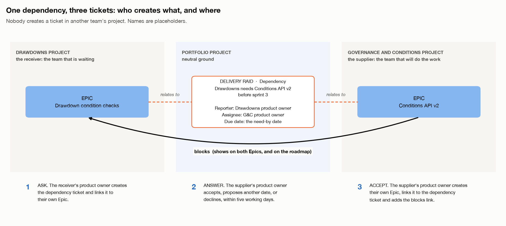

*Figure 16. One dependency, three tickets, three projects. Each product owner touches only their own ticket and the shared dependency ticket.* **Hosted in: Diagram.**

| # | Step | Who | In Jira |
| --- | --- | --- | --- |
| 1 | **Ask** | Product owner of the waiting team (the receiver) | Creates a Delivery RAID ticket in the portfolio project: RAID Type Dependency; a summary that says who needs what by when; Due date as the need-by date; the supplier in Supplier Value Stream and Sub Value Stream; the supplier's product owner as Assignee. Links it to the waiting Epic with **relates to**. Status: Backlog. |
| 2 | **Answer**, within five working days | Supplier's product owner | Accepts, proposes another date, or declines with a reason, as a comment. An ask with no answer after five working days goes to the weekly delivery sync. |
| 3 | **Accept** | Supplier's product owner | Creates or names the Epic or Story in their own project that will deliver it. Links it to the dependency ticket with **relates to**, and to the waiting Epic with **blocks**. Sets Baseline End Date on the dependency ticket to the date promised. Moves the dependency ticket to In Progress. |
| 4 | **Plan** | Both product owners, at PI planning | The supplier's ticket has a Target PI and an end date before the need-by date. The dependency board on the PI plan page shows the need-by date against the promised date. |
| 5 | **Deliver** | Supplier | The supplier's ticket is finished. The supplier comments on the dependency ticket. |
| 6 | **Close** | Receiver | Confirms that what was delivered is usable, and moves the dependency ticket to Done. Only the receiver closes it. |

**What the status of a dependency ticket means**

| Status | Means | Seen as |
| --- | --- | --- |
| Backlog | Asked, not yet agreed | The chase list: "asked, not agreed" |
| In Progress | Agreed: the supplier's work is named, linked and dated | "What we owe" for the supplier; "what we wait for" for the receiver |
| Done, resolution Done | Delivered and accepted by the receiver | Counted as met, on time or late |
| Done, resolution Won't Do | Declined, or no longer needed, with the reason | The product leads decide the alternative |

**RAG on a dependency ticket** is the receiver's judgement of whether the need-by date will be met. Green: agreed and on track. Amber: not agreed within five working days, or the supplier's date is at risk. Red: the need-by date will be missed, or the ask was declined with no alternative.

### Where a RAID ticket is linked: Epic, Feature or VS Epic

A RAID ticket is linked at the level where the impact is felt, and no higher than is true.

| Linked to | When | Example |
| --- | --- | --- |
| **Epic** | One application's work is affected | A team blocked during development; an environment missing for one team |
| **Feature** | The commitment of the whole Feature is threatened, or several applications are affected by the same thing | One risk raised once, not three times by three teams |
| **Milestone** | A date that people outside the teams care about is threatened | A risk to a regulatory deadline |
| **VS Epic** | The outcome itself is in question | A change in the business case; a dependency on another value stream's programme |

A ticket first linked to an Epic is linked upward by the delivery lead when the impact grows. **The link level is therefore a statement about impact**, and moving a link up is an escalation that everyone can see.

**Why show RAID at Feature level at all?**

- **The Feature is where applications meet.** A risk in one application threatens the commitment of all of them. The product lead, who decides what gives, works at Feature level.
- **One risk, one ticket.** Three teams hit by the same problem link to one ticket on the Feature, instead of raising three.
- **It explains the colour.** A Feature that is Amber shows the tickets that make it Amber, with their owners and dates, on the Feature itself.
- **It feeds the levels above.** Milestones and VS Epics are judged from their Features; a risk that is visible on the Feature is not a surprise at the portfolio sync.
- **It makes the PI commitment honest.** At the lock, each Feature's open risks and unagreed dependencies are read out before it is labelled committed.

**The dashboards do not depend on the links.** Every Delivery RAID ticket carries its own sub value stream, supplier, type, RAG and date, so the value stream lists and counts are built from the RAID tickets themselves. Links are for navigation: each ticket shows what it waits for and what waits for it. To see RAID by application, the portfolio project has one Component per application, set on the RAID ticket to the application that is affected.

### Dependencies in the PI plan

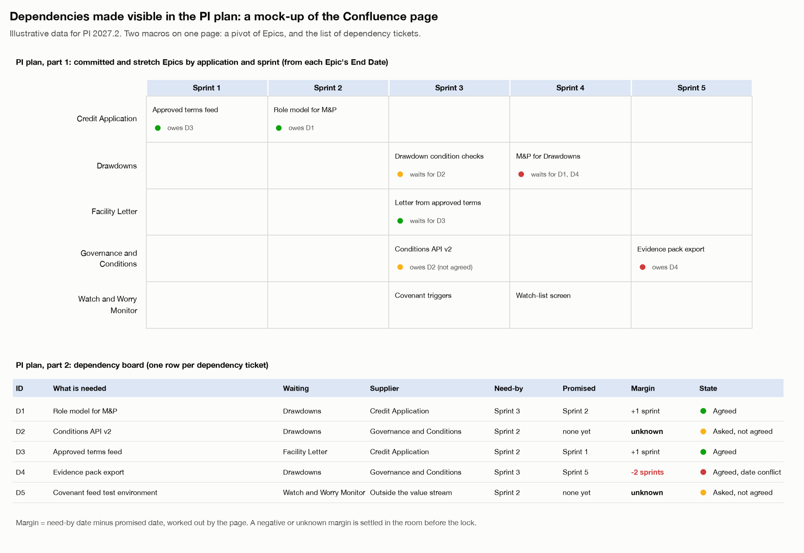

*Figure 17. The PI plan page in Confluence: Epics by application and sprint, and the dependency board beneath. A card wall with arrows between cards is not possible on a Confluence page; the margin column does that job.* **Hosted in: Confluence.**

**Two dates on one ticket make a dependency checkable.** On every dependency ticket, **Due date** is the date the receiver needs it, and **Baseline End Date** is the date the supplier has promised. The page subtracts one from the other. A positive margin is safe; a negative margin is a conflict; no promised date means the ask is not yet agreed. Because both dates sit on the dependency ticket, the board needs no join across projects and works for dependencies on outside parties too.

**What the blocks link adds.** The blocks link between the two Epics makes each Epic show, on its own screen, what it waits for and what waits for it. The dependency board does not rely on it.

**The dependency sweep, on the PI calendar**

| When | What | Who |
| --- | --- | --- |
| Design (Feature in Analysis) | Applications are named and their Epics created. Sequence is linked with blocks. Asks to teams outside the Feature are raised. | Product lead, product owners |
| Week 8 of the current PI | Every ask for the next PI has been raised | Receiving product owners |
| Week 10 | Every ask has an answer: accepted with a date, a counter-proposal, or declined | Supplying product owners |
| PI planning, day 1 | Teams draft their plans. At the end of the day the delivery leads walk the dependency list: asks not agreed, date conflicts, anything found in the room. | Delivery leads |
| PI planning, day 2 | Conflicts are settled: move the supplier earlier, move the receiver later, cut scope, or accept the risk by name. Risks are reviewed one by one and given a ROAM response. | Product leads; value stream lead for conflicts between sub value streams |
| The lock | The lock rule below is applied: no negative or unknown margin behind a committed Epic. The dependency board is pasted into the PI scorecard beside the baseline. | Delivery lead |
| Each week of the PI | The delivery sync opens on the delivery lead view and the dependency dashboard: due in the next two sprints, past the need-by date, flagged now | Delivery lead |
| PI close | Each dependency is scored: met on time, met late, not met. Spillovers with the reason "Dependency" are matched to them. | Delivery lead |

**The lock rule.** An Epic is labelled `pi-committed` only when every dependency it waits on is agreed and planned to finish before it is needed. Otherwise the Epic is `pi-stretch`, or the value stream lead accepts the risk by name on the RAID ticket (ROAM Response: Accepted). A Feature is committed only when all its Epics are.

### Who is responsible

One sentence first: **the delivery lead owns the process and the register; product owners own the individual asks and promises; product leads own the trade-offs.**

| Role | For dependencies | For risks, assumptions and issues |
| --- | --- | --- |
| **Engineers, testers** | Flag the ticket when stopped. Tell the product owner the same day when work turns out to need another team. | Say so at stand-up |
| **Scrum master, team lead** | Keeps flags true. Raises a RAID ticket when a flag has been on for two working days. Clears what the team can clear itself. | Raises what the team cannot solve |
| **Product owner (receiving)** | Raises the ask. Owns chasing it. Keeps the need-by date and RAG true. Closes the ticket when the delivery is usable. | Raises risks and issues on their Epics |
| **Product owner (supplying)** | Answers within five working days. Creates their own work ticket, links it, plans it, delivers it. | |
| **Product lead** | Names the applications a Feature needs. Decides what gives when a supplier cannot fit the work. Will not commit a Feature with an unagreed dependency. | Owns the response to risks on their Features |
| **Delivery lead** | **Owns the register and the process.** Triages every new RAID ticket within two working days: is it the right type, linked, owned, dated. Runs the weekly review and the dependency sweep at PI planning. Chases outside parties, or names who does. Links upward when the impact grows. | The same, for every type; runs the monthly RAID review |
| **Value stream lead** | Decides conflicts between sub value streams. Is the only person who accepts a risk to a committed Feature. | Decides Red items at the portfolio sync |
| **Platform team, framework owner, PMO** | Owns the method: the rules, the filters, the dashboard, the measures and their trend. Does not own individual tickets. | The same |

This follows the usual division in scaled agile practice, where one facilitating role (the release train engineer) keeps the planning board current, looks for dependency patterns and runs the risk review at PI planning, while teams raise and commit. The delivery lead plays that part here. The split between receiving and supplying product owners, and the rule that the supplier creates its own ticket, are this framework's proposal; no published standard was found that prescribes them.

### The dependency dashboard

Dashboard 6, for delivery leads and product owners. It is the opening screen of the weekly delivery sync.

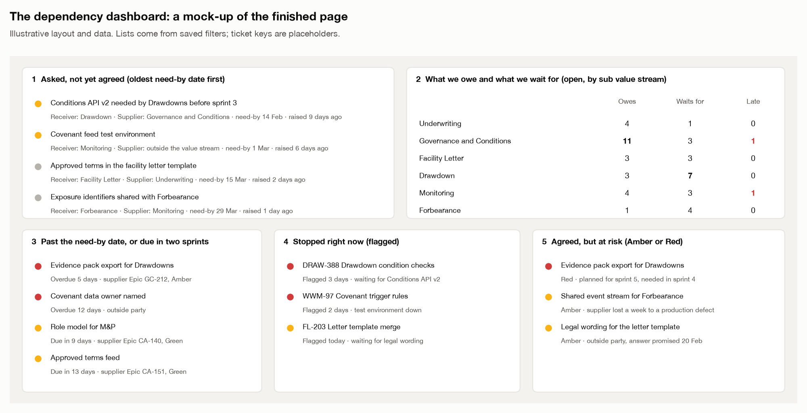

*Figure 18. Mock-up of the dependency dashboard.* **Hosted in: Jira.**

| # | Gadget | Filter | Question answered |
| --- | --- | --- | --- |
| 1 | Filter Results, with Linked Issues, supplier, Due date and Created | `VS: dependencies not agreed` | Which asks have no answer, and how old are they? |
| 2 | Two Dimensional Filter Statistics, supplier by Status | `VS: open dependencies` | What does each sub value stream owe? |
| 3 | Two Dimensional Filter Statistics, sub value stream by RAG Status | `VS: open dependencies` | What is each sub value stream waiting for, and how worried is it? |
| 4 | Filter Results, by Due date | `VS: dependencies late or due soon` | What is past its need-by date, or due in the next two sprints? |
| 5 | Filter Results | `VS: flagged` | What is stopped right now? |
| 6 | Filter Results, with Path to Green | `VS: dependencies at risk` | Which agreed dependencies are Amber or Red? |
| 7 | Filter Results | `VS: dependencies without an owner or date` | Which asks cannot be chased? |
| 8 | Filter Results, with Linked Issues | `Team: Epics blocked by others` (one per team dashboard) | What is our team waiting on? |

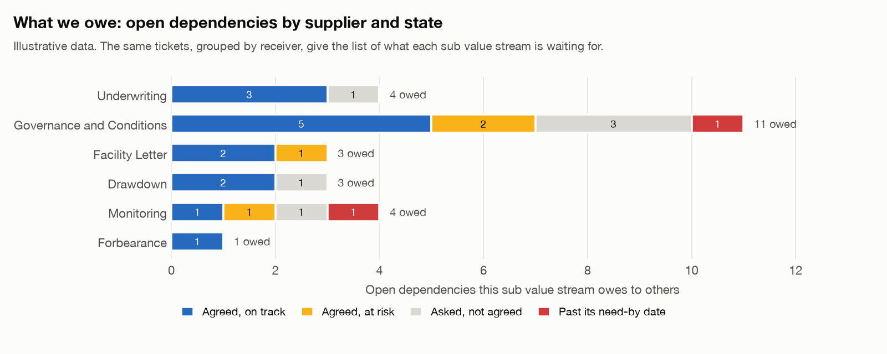

*Figure 19. What each sub value stream owes, by state. The same tickets grouped by receiver give "what we wait for".* **Hosted in: Jira.**

**The filters**

| Save as | Query |
| --- | --- |
| VS: open dependencies | `filter = "VS: open RAID" AND "RAID Type" = Dependency ORDER BY duedate` |
| VS: dependencies not agreed | `filter = "VS: open dependencies" AND status = Backlog ORDER BY duedate` |
| VS: dependencies agreed | `filter = "VS: open dependencies" AND status = "In Progress"` |
| VS: dependencies late or due soon | `filter = "VS: open dependencies" AND duedate <= endOfDay("+28d") ORDER BY duedate` |
| VS: dependencies at risk | `filter = "VS: open dependencies" AND "RAG Status" in (Amber, Red)` |
| VS: dependencies without an owner or date | `filter = "VS: open dependencies" AND (assignee is EMPTY OR duedate is EMPTY)` |
| VS: dependencies closed this PI | `project = CLP AND issuetype = "Delivery RAID" AND "RAID Type" = Dependency AND resolved >= "2027-01-04"` (the first day of the PI) |
| Everything linked to one ticket | `issue in linkedIssues("CLP-123")`, for one key at a time |

**Three views, three jobs**

| View | Where | Shows |
| --- | --- | --- |
| The dependency dashboard | Jira | The register: every ask, its state, owner and date |
| The dependency board | Confluence, on the PI plan page | Every dependency of the PI with need-by date, promised date and margin; conflicts and unagreed asks stand out |
| The dependency trend pages | Confluence | The matrix of who waits on whom (figure 13), and dependencies met on time, PI after PI |

**What standard Jira cannot do here**

| Wanted | Limit | Way round |
| --- | --- | --- |
| "Committed Epics that wait on an unagreed ask" as one list | A query cannot follow a link from one filter's results to another's | The "not agreed" list shows each ask's linked Epic in the Linked Issues column; the delivery lead reads it at the lock |
| RAID tickets linked to the Epics of a Feature, shown on the Feature | Same limit | The link upward (step 4), or a Confluence page that joins on the Linked Issues column, to be tested |
| A list of every Epic that blocks another | The `issueLinkType` query field may not exist on this Jira version | The dependency board lists every managed dependency; the Linked Issues column shows the rest; proof-of-concept check 10 |

### How dependency management will be measured

These measures are this framework's proposal; no published benchmark was found for them.

| Measure | What it shows |
| --- | --- |
| Asks not agreed, and their age | Whether suppliers answer |
| Dependencies agreed before the lock, as a share of all dependencies in the PI | Whether dependencies are found at planning or during the PI |
| Dependencies met by the need-by date | Whether promises between teams hold |
| Days flagged, per PI | How long teams sit stopped |
| Spillovers with the reason "Dependency" | What unmanaged dependencies cost |
| The busiest supplier and receiver pairs | Where a standing agreement, a shared roadmap or a change of team boundaries would pay |

### Delivery RAID: the four types

Delivery RAID tickets live only in the portfolio project and are always linked to the work they affect. They are raised by product owners, scrum masters, delivery leads and product leads; anyone else asks one of them.

| RAID Type | Raise it when | Fields that must be filled | Closes when |
| --- | --- | --- | --- |
| Risk | Something may go wrong and would move an Epic date, a Feature date or a Milestone | Probability, Impact, Impact Details, Risk Trigger Event, ROAM Response, Due date as the next review date | The response is Resolved or Accepted, or the event has passed |
| Assumption | A plan depends on something not yet confirmed | The assumption, who can confirm it, Due date as the confirm-by date | Confirmed, or converted to a risk or issue |
| Issue | Something has gone wrong and needs help from outside the team | Impact, Impact Details, Path to Green, Date to Green, RAG Status | Resolved |
| Dependency | Work or a decision is needed from a team outside the Feature, another value stream, or an outside party; or a dependency inside a Feature is not agreed or is at risk | Supplier Value Stream and Sub Value Stream, Dependency Type, Assignee (the supplier), Due date as the need-by date, Baseline End Date as the date the supplier promised | Delivered and accepted by the receiver |

Every Delivery RAID ticket has an assignee, a Due date, a RAG Status, and a link to at least one Epic, Feature, VS Epic or Milestone.

ROAM Response on a risk means: **R**esolved, **O**wned (a named person is acting), **A**ccepted (the sponsor has agreed to live with it), **M**itigated. A risk with no response has not been reviewed. An accepted risk is not closed: it stays open with the name of the person who accepted it and a date for the next review.

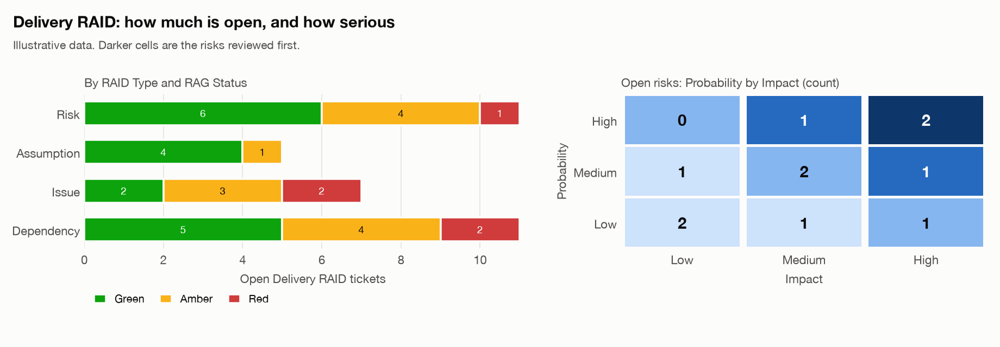

*Figure 20. Open Delivery RAID by type and RAG, and open risks by Probability and Impact.* **Hosted in: Jira.**

### Milestones

| Kind | Example | Label |
| --- | --- | --- |
| Regulatory or audit date | Remediation of an audit finding due | `ms-regulatory` |
| Go-live | A module live for a business line | `ms-golive` |
| PI boundary | PI planning, PI end demo | `ms-pi` |
| External commitment | A data feed from another division available | `ms-external` |

- **Baseline End Date** is the date first committed and is never changed. **Due date** is the current target. The gap is the slippage.
- When Due date moves, the reason goes in a comment, and Path to Green and Date to Green are updated.
- Every Feature or VS Epic that must finish for the date is linked with **blocks**, so the Milestone lists everything it is waiting for.
- Regulatory Milestones carry the Regulatory or Control ID. A regulatory Feature is planned before scored work and is never labelled stretch.

*Figure 21. Milestone slippage, read from two existing date fields.* **Hosted in: Confluence.**

## 13. Managing the portfolio

A large portfolio goes wrong in a few predictable ways: too much is started, nobody wrote down what an outcome was meant to achieve, and reports describe activity. Six practices at VS Epic level address those, using fields the VS Epic already has.

| Practice | What it is | How it runs |
| --- | --- | --- |
| A stated outcome and case on every VS Epic | Before analysis is approved, the VS Epic says what will improve, by how much, at what rough cost and risk | Business Benefits and the impact fields on the VS Epic, plus a one-page case in Confluence. Required to leave Analysis. |
| A limit on work in progress | A cap on how many VS Epics may be in Analysis and in Implementing at once | Column limits on the VS Epic board. Breaches are discussed at every portfolio sync. |
| A link to strategy | Every VS Epic names the objective it serves | Objective ID on the VS Epic |
| Investment mix | The share of capacity going to each kind of work, against the intended share | Confluence page: story points by objective and by Enabler Type |
| Benefits review | Three and six months after release, a named owner measures the promised benefit | A VS Epic stays at Released until the review is recorded, then moves to Done |
| A rule for stopping | Agreed grounds for stopping a VS Epic | Decided at the portfolio sync; closed as Won't Do with the reason |

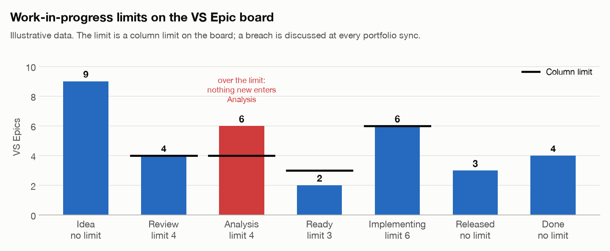

*Figure 22. Work-in-progress limits on the VS Epic board. Limits start from the number of people able to lead an analysis and the number of VS Epics the teams can carry in parallel.* **Hosted in: Jira.**

### Investment mix and capacity split

Before each PI, every team reserves capacity by kind of work, so urgent items cannot crowd out the rest. A starting split, to be adjusted from each team's own history after two PIs:

| Kind of work | Starting share | Counted from |
| --- | --- | --- |
| Committed Features, business | 50% | Epics whose Feature has no Enabler Type |
| Enablers, resilience and technical debt | 15% | Enabler Type; Contains Resiliency Work |
| Regulatory and control change | By demand, planned first | Regulatory or Control Change Type |
| Run work, production defects and incidents | 20% | Bugs, and Epics under "Run and improve" |
| Unplanned reserve | 15% | Tickets labelled `unplanned` |

The shares are a proposal, not a finding (decision 9 in section 20).

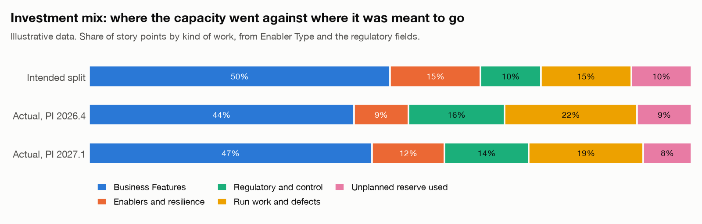

*Figure 23. Intended split against what was actually done.* **Hosted in: Confluence.**

### Size and forecast of a VS Epic

For each application under a VS Epic: remaining points divided by that team's PI velocity gives the PIs still needed. The VS Epic finishes when its slowest application does.

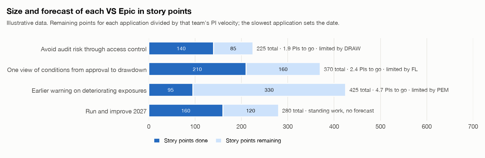

*Figure 24. One line per VS Epic: total, done, remaining, PIs to go, and the application that limits it.* **Hosted in: Confluence.**

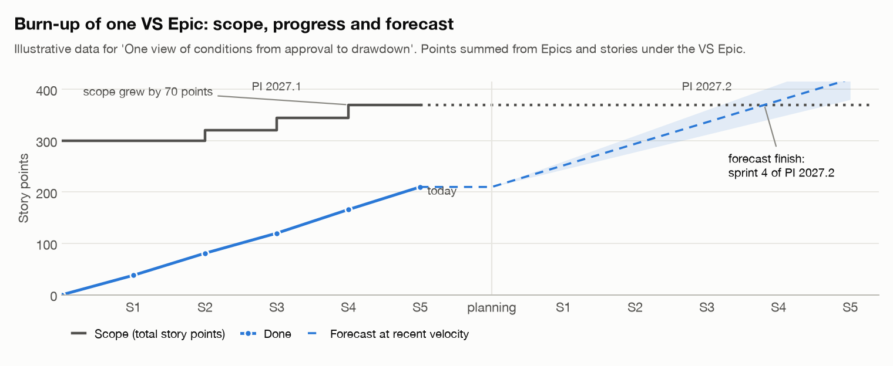

*Figure 25. Burn-up of one VS Epic. Scope growth is shown separately from progress, so a moving target is not mistaken for slow delivery.* **Hosted in: Confluence.**

### Velocity above the team

| Measure | What it is | Used for |
| --- | --- | --- |
| Team velocity | Story points finished per sprint, average of the last three | Team capacity at PI planning |
| PI velocity, per application | Story points finished in a PI by those teams | How much can be taken into the next PI |
| Planned against delivered | Points with this Target PI at the lock, against points finished | Whether plans are realistic |
| Feature throughput | Features reaching Released per PI | The outcome view; harder to inflate than points |

*Figure 26. PI velocity by application. Story points mean different things in different teams, so this chart compares each application with its own past only.* **Hosted in: Confluence.**

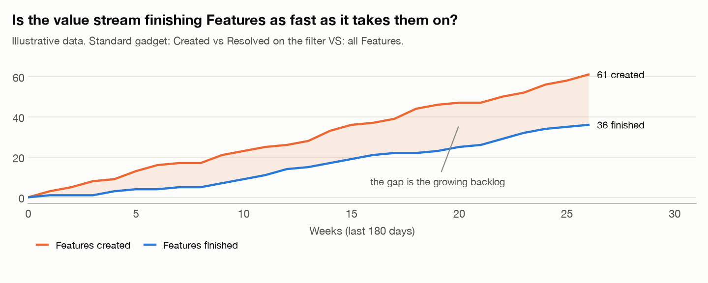

*Figure 27. Features created against Features finished. A widening gap means the value stream is taking on more than it finishes.* **Hosted in: Jira.**

### Twelve questions the value stream lead answers every month

| # | Question | Answered from |
| --- | --- | --- |
| 1 | Which VS Epics are in progress, and are we inside the limit? | Jira: VS Epic board |
| 2 | Which VS Epics are Red or Amber, and what is the path to green? | Jira: dashboard 1 |
| 3 | Which Features under each VS Epic are late or spilled? | Confluence: portfolio tree |
| 4 | How far is each VS Epic, in Features and in story points? | Confluence: portfolio tree and forecast |
| 5 | Did we deliver what we committed last PI? | Confluence: PI scorecard |
| 6 | What is stuck, and for how long? | Jira: Analysis over 30 days; spillover |
| 7 | Where is capacity going, by objective and by kind of work? | Confluence: investment mix |
| 8 | Is demand for the next PI above capacity? | Confluence: PI plan page, capacity table |
| 9 | Which dependencies across applications are open, unagreed or overdue? | Jira: dashboard 6; Confluence: dependency board |
| 10 | Which risks and issues need a decision? | Jira: dashboard 4 |
| 11 | Which dates have moved? | Confluence: milestone slippage |
| 12 | Which released VS Epics are due a benefits review? | Jira: VS Epics at Released |

---

# Part D: Seeing it

## 14. Dashboards and reports

Reporting runs top-down in one line: VS Epics, then Features across the whole value stream, then Epics across applications, then the team. **There is no separate set of views per sub value stream.** The sub value stream is a column to sort or group by, never a filter that hides the rest.

Three places hold the views. Two of them are where people look every week; the third is kept for the roadmap.

| Place | Best for | Cannot do |
| --- | --- | --- |
| **Jira dashboards** (standard gadgets on saved filters) | Live lists and counts: what is Red, what is flagged, what is overdue, status by application | Roll up the hierarchy; compare today with what was planned; show trends across PIs |
| **Plans** | One thing only: the L0 roadmap | Be read easily by most people, which is why nothing else is put there |
| **Confluence** (Jira Issues macro, Table Transformer, Pivot Table, Chart from Table) | The main place to look. Roll-ups across applications; the PI plan; capacity; the dependency board; trends across PIs; slippage; the PI scorecard and its baseline; one page per role | Show more than about 1,000 issues per macro; update without a page reload; be edited by drag and drop |

### The six Jira dashboards

| # | Dashboard | For | Answers |
| --- | --- | --- | --- |
| 1 | Value stream portfolio | Value stream lead, sponsors | What are the outcomes, how is each going, what needs a decision, which dates are close |
| 2 | Features across the value stream | Product leads, delivery leads | What is being delivered this PI and under which VS Epic; what is off track; what is ready next |
| 3 | Epics across applications | Delivery leads, product owners | How far each application is with its share; which application spills; what is blocked or not started |
| 4 | Risks, dates and releases | Delivery leads | Serious risks and issues; who is waiting on whom; which dates moved; is the next release ready |
| 5 | Team (one per application team) | Product owner, scrum master | Sprint health; what is blocked today; what rolled over; what the team is waiting on; which Epics are invisible to the portfolio |
| 6 | Dependencies | Delivery leads, product owners | Which asks have no answer; what each sub value stream owes and waits for; what is late or due soon; what is stopped now (section 12) |

Each dashboard uses ten gadgets or fewer, all standard: Filter Results, Pie Chart, Two Dimensional Filter Statistics, Created vs Resolved, Sprint Health, Sprint Burndown.

*Figure 28. Mock-up of dashboard 1. The real page is assembled from standard gadgets; the layout will differ in detail.* **Hosted in: Jira.**

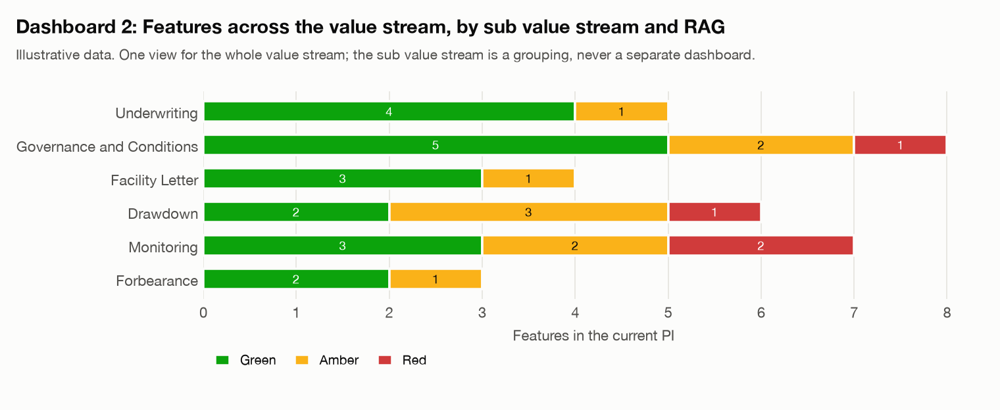

*Figure 29. Dashboard 2: Features across the value stream, grouped by sub value stream.* **Hosted in: Jira.**

*Figure 30. Dashboard 3: Epics across applications.* **Hosted in: Jira.**

### One page for each role

The dashboards above are organised by level of the hierarchy. Three roles asked for a single page that answers their own questions. Each is one Confluence page built from the same saved filters, so the numbers agree with every other view.

**Delivery lead: what is blocked, what is progressing**

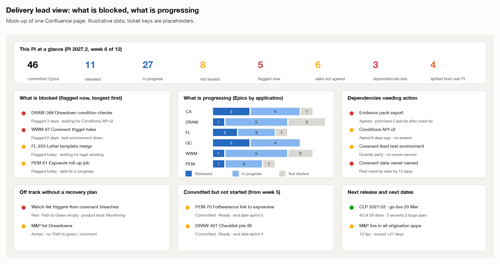

*Figure 31. Delivery lead view.* **Hosted in: Confluence.**

| Panel | Question | Source |
| --- | --- | --- |
| This PI at a glance | How much of the commitment is released, in progress, not started | Counts from `VS: PI Epics`, `VS: flagged`, `VS: dependencies not agreed`, `VS: spillover` |
| What is blocked | What is stopped right now, and for how long | `VS: flagged`, oldest first |
| What is progressing | How far is each application | `VS: PI Epics`, pivoted by project and status |
| Dependencies needing action | Which asks are unanswered, late or in conflict | `VS: open dependencies`, with the margin worked out |
| Off track without a recovery plan | Who claims Amber or Red with no plan | `VS: Amber or Red without a plan` |
| Committed but not started | What is at risk of spilling | `VS: PI Epics not started`, from week 5 |
| Next release and next dates | Is the release ready; which dates are close | `Release: not finished`; `VS: Milestones next 90 days and overdue` |

**Platform owner: what came in, and how things are moving**

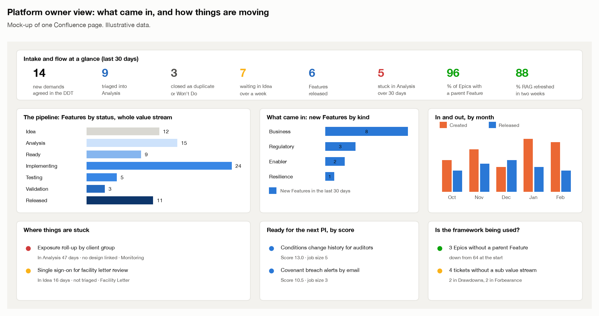

*Figure 32. Platform owner view.* **Hosted in: Confluence.**

| Panel | Question | Source |
| --- | --- | --- |
| Intake and flow at a glance | How much came in, was triaged, was closed, was released in the last 30 days | Features created, moved to Analysis, closed and released in the period |
| The pipeline | How many Features sit in each status | `VS: all Features`, counted by status |
| What came in | What kind of work is arriving | New Features by Enabler Type and regulatory type |
| In and out, by month | Is the value stream finishing as fast as it takes on | Features created against Features released, by month |
| Where things are stuck | What has waited too long | `VS: intake waiting` over a week; `VS: Analysis over 30 days` |
| Ready for the next PI | What is next, best value first | `VS: Ready, no Target PI` |
| Is the framework being used? | Is the data good enough to trust | The hygiene filters, counted |

Jira records when a ticket was created, resolved and last changed status, so counts and ages are exact. The average time a Feature spends in each status is not available without an add-on.

**Product owner: my application's Epics, in progress and done**

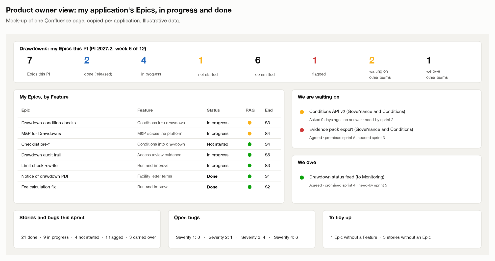

*Figure 33. Product owner view. One page per application, copied from a template with the project key changed.* **Hosted in: Confluence.**

| Panel | Question | Source |
| --- | --- | --- |
| My Epics this PI | How many are done, in progress, not started, committed | The application's Epics in `VS: PI Epics` |
| My Epics, by Feature | Where is each Epic, and which Feature does it serve | The same, with Parent Link, Status, RAG and End Date |
| We are waiting on | What do we need from others, and is it agreed | Dependency tickets where this application is the one waiting |
| We owe | What have others asked of us | Dependency tickets assigned to this product owner |
| Stories and bugs this sprint | How is the sprint going | The team's open sprint |
| Open bugs | How many, how serious | `Team: open bugs` |
| To tidy up | What is invisible to the portfolio | `Team: Epics without Feature`; `Team: Stories without Epic` |

### The two boards

| Board | Columns | Notes |
| --- | --- | --- |
| VS Epic board | The VS Epic statuses | Column limits for work in progress |
| Feature board | The Feature statuses | One swimlane per VS Epic; card colours by RAG Status; quick filters for Current PI, Committed, Red and Amber, Flagged |

Neither board is split by sub value stream. Each application team keeps its own Scrum or Kanban board.

### The Confluence portfolio pages

| Page | Built from | Shows |
| --- | --- | --- |
| Portfolio tree | VS Epics and Features joined on parent | Each VS Epic with its Features counted: released, Red, late |
| Feature progress across applications | Epics of the PI grouped by parent Feature | Figure 9: one row per Feature, its Epics by application, and the worst RAG among them |
| PI scorecard (one page per PI) | The pasted baseline table joined to that PI's own filter | Figure 10: what happened to every committed line; also holds the PI objectives |
| Predictability trend | Committed Features and Epics with Target PI and Actual PI | Figure 11 |
| Size and forecast by VS Epic | Epics under open VS Epics with Story Points, joined upward | Figure 24 |
| PI velocity | Stories and bugs resolved in the PI, summed by project | Figure 26 |
| Investment mix | Features with Enabler Type and their Epics' points | Figure 23 |
| Milestone slippage | Milestones with Baseline End Date and Due date | Figure 21 |
| Weekly status report | Red and Amber tickets with Executive Summary and Path to Green | The exceptions report for the portfolio sync, in the owners' own words |
| Roadmap | The shared Plans view, or VS Epics drawn as a Gantt chart | Figure 5 |
| PI plan (one page per PI) | Features and Epics of the PI; a typed capacity table; the dependency tickets | Figures 8 and 17: Epics by application and sprint, load against capacity, the dependency board |
| Delivery lead view, platform owner view, product owner view | Saved filters, summarised | Figures 31 to 33 |
| Dependencies | Delivery RAID dependencies pivoted by receiver and supplier; dependencies met on time, per PI | Figure 13 |

### Where each figure in this paper would be built

The figures in this paper were drawn for the paper. Thirty of the 35 can be built on a Confluence page with the installed macros (the Jira Issues macro, Table Transformer, Pivot Table and Chart from Table); five are explanatory diagrams and are used as images. They will appear as standard bars, lines and tables, not in the exact styling shown here. Step-by-step build instructions for every figure are in section 8 of the [Confluence guide](../confluence/CONFLUENCE_PORTFOLIO_GUIDE.md). The table says where the live equivalent comes from. Four are marked as not available from standard tools, or only with extra upkeep.

| Figure | Live source | Notes |
| --- | --- | --- |
| 1 Success measures | Confluence: a small table of counts from the hygiene filters, charted | Counts are typed in monthly; Jira keeps no history of them |
| 2 Hierarchy, 4 Lifecycle, 7 PI calendar, 15 Escalation ladder, 16 Dependency linking | Explanatory diagrams | Not built from data; used as images |
| 3 Field shortlist, 35 Rollout | Confluence: a typed table, charted (stacked bar; Gantt) | Not live data |
| 5 L0 roadmap | Plans: saved view "L0 roadmap" | Fallback: Confluence Gantt with Chart from Table |
| 6 WSJF ranking | Jira: Filter Results sorted by score | As a bar chart: Confluence Chart from Table |
| 8 Capacity against demand | Confluence: PI plan page; Epic story points summed by application against a typed capacity table | Sprint-by-sprint load stays on each team board |
| 9 Feature progress across applications | Confluence: Table Transformer and Pivot Table | Appears as a table; cell colours need the macro's conditional formatting |
| 10 PI scorecard, 11 Predictability trend | Confluence: baseline table joined to live Jira data | The core Confluence pages |
| 12 Spillover reasons | Confluence: counted from the reason column on the scorecard | |
| 13 Dependency matrix | Confluence: Pivot Table on Delivery RAID dependencies | Appears as a table of counts |
| 14 Release readiness | Jira: dashboard 4 gadgets | |
| 17 PI plan page with dependency board | Confluence: a pivot of Epics by application and sprint, and the dependency tickets with a calculated margin | Buildable with the installed macros; to be proven in the proof of concept |
| 18 Dependency dashboard | Jira: dashboard 6, standard gadgets on the dependency filters | |
| 19 Dependencies by supplier | Jira: Two Dimensional Filter Statistics, supplier by Status | If the supplier field is a two-step dropdown the gadget may refuse it; then Confluence Pivot Table |
| 20 RAID overview | Jira: Two Dimensional Filter Statistics | Works if the fields are plain dropdowns; to be tested |
| 21 Milestone slippage | Confluence: date difference with Table Transformer | |
| 22 WIP limits | Jira: column limits on the VS Epic board | The board shows the breach; the bar chart is illustration |
| 23 Investment mix, 24 Points per VS Epic, 26 PI velocity | Confluence: Table Transformer sums, charted | |
| 25 VS Epic burn-up | **Not standard.** Jira keeps no history of scope and progress | Needs a small table updated each sprint on Confluence, or an add-on |
| 27 Created versus resolved | Jira: Created vs Resolved gadget | |
| 28 Dashboard mock-up, 29, 30 | Jira: dashboards 1, 2 and 3 | Figure 29 depends on the sub value stream field working as a gadget axis; fallback in section 17 |
| 31 Delivery lead view, 32 Platform owner view, 33 Product owner view | Confluence: one page each, built from saved filters with Table Transformer | Time spent in each status is not available without an add-on |
| 34 Hygiene trend | Confluence: monthly counts typed into a table, charted | **Manual monthly entry**; Jira keeps no history |

### What standard Jira cannot show, and the way round it

| Wanted | Why a gadget cannot | Where it comes from |
| --- | --- | --- |
| Percentage complete of a Feature from its stories | Gadgets do not roll up the hierarchy | Confluence: portfolio tree and Feature progress pages |
| Feature progress across applications as a table | Same reason | Confluence |
| Predictability trend across PIs; scope added and removed | Jira keeps no snapshot of what was planned | Confluence, from the pasted baseline |
| Time spent waiting versus working | Needs time in each status | An add-on, or an export to a reporting tool |
| Deployment frequency and failure rate | That data sits in release and incident tools | Those tools |

### Data quality

The views are only as good as the tickets. Six hygiene filters are reviewed monthly, and the count per application is published.

| Filter | Why it matters |
| --- | --- |
| Epics without a parent Feature | Work the portfolio cannot see |
| Tickets without a sub value stream | Missing from every grouped view |
| Released without Actual PI | Predictability cannot be counted |
| In progress without Target PI | Work started outside the PI plan |
| Done without resolution | Missed by the trend gadgets |
| Open with a resolution | Wrongly counted as finished |

*Figure 34. Hygiene exceptions over the first six months. The expected shape: a steep fall during stitching, then a low level held by the monthly check.* **Hosted in: Confluence.**

---

# Part E: Running it

## 15. Roles: what changes for whom

### Before and after, by role

| Role | Stops | Starts | Keeps |
| --- | --- | --- | --- |
| **Value stream lead** | Asking for slide packs before each review | Running the portfolio sync from dashboard 1 and the VS Epic board; keeping VS Epic status, RAG and Executive Summary current fortnightly; deciding order and limits | Accountability for outcomes and priorities |
| **Head of product, product leads** | Tracking Features in spreadsheets; negotiating scope per application | Owning Features in the portfolio project; scoring and ranking them; committing a Feature only when every application has committed its Epic; weekly Feature RAG | Ownership of scope and acceptance |
| **Head of technology** | Receiving capacity and dependency news late and by word of mouth | Reading capacity against demand, investment mix and dependency views from one place; sponsoring the administrator requests; holding technology leads to the definition of done | Accountability for engineering capacity, quality and the platform |
| **Delivery leads** | Assembling status by hand; keeping a private list of what was committed | Owning the dependency and RAID register and its process (triage in two working days, weekly review, the dependency sweep at PI planning); owning Milestones, release versions and the per-PI filter edits; pasting the baseline at the lock; running the PI scorecard | Running delivery and release governance |
| **Application product owners** | Planning their application in isolation; asking other teams for work by message or by creating tickets in their projects | Giving every Epic a parent Feature; setting Target PI and the commitment label at PI planning; raising asks to other teams as dependency tickets, and answering asks addressed to them within five working days; ten minutes weekly on status, RAG, date and release | Ownership of the application backlog and its Epics |
| **Requesters** | Asking a team or a lead directly | Raising a request through the portal, and following it there | Sponsorship and acceptance of the result |
| **DDT members** | Deciding from papers or slides prepared for the meeting | Deciding from the intake queue on screen, with each request already assessed; recording the decision on the request in the meeting | The authority to take on, decline or park new demand |
| **Intake owner (platform team)** | Demand arriving by many routes | Screening every request within 5 working days; routing it; keeping the intake queue honest | |
| **Business analysts, designers** | Design decisions living only in documents | Building the Feature in Analysis: Acceptance Criteria, design link, the list of applications, sign-off tasks | Analysis and design work itself |
| **Scrum masters, team leads** | Rolling every unfinished story over by default | Sprint naming to the convention; checking every story has an Epic; closing sprints on the last day | Running the team's sprint events |
| **Engineers, testers** | Nothing | Using the flag when blocked, and removing it the same day; raising Bugs under the right Epic with Severity, Testing Phase and Environment | Daily story updates, as now |
| **Jira administrators** | Fielding one-off requests from each team | Eight requests (section 17); a single framework owner as the point of contact | Central control of fields, statuses and schemes |

### The one-minute card for working-level people

| When | Do this |
| --- | --- |
| You start a piece of work | Move it to In Progress. Make sure it is assigned to you and is in the sprint. |
| You are stopped by something outside your control | Flag the ticket and add one line saying what you are waiting for and from whom |
| You are no longer stopped | Remove the flag the same day |
| You finish | Move it to Done, having checked the definition of done |
| You find a defect | Raise a Bug under the right Epic, with Severity, Testing Phase and Environment |
| You discover your work needs another team | Tell your product owner the same day, so the ask can be raised and the two Epics linked. Do not create a ticket in the other team's project. |
| A flag has been on for two working days | Ask your scrum master or product owner to raise a Delivery RAID ticket |
| You realise it will not finish this sprint | Say so at stand-up. Do not wait for the last day. |

Three things to remember: **status is true today, blocked means flagged, and every story has an Epic.**

Working-level people never need to touch Target PI, Actual PI, RAG Status, Parent Link, commitment labels or the Fix version on Epics.

### What is kept up to date, and how often

| How often | Epic (product owner) | Feature (product lead) | VS Epic (value stream lead) | Milestone and Delivery RAID (delivery lead) |
| --- | --- | --- | --- | --- |
| **The same day** | Flag on or off. Status when it changes. A new dependency linked. | Flag. Management Attention when a decision is needed now. | Flag | A new risk, issue or outside dependency raised with an owner |
| **Weekly** | Status. RAG. End Date still true. Fix versions. Recovery plan if Amber or Red. | Status against its Epics. RAG. Path to Green and Date to Green if Amber or Red. Due date. | | Blockers past their date chased. Flags reviewed. |
| **Fortnightly** | | | Status. RAG. Executive Summary. Rank order. | Every Red and Amber RAID ticket. Milestone dates and RAG. |
| **Monthly** | Hygiene: no Epic without a parent | Hygiene: no Feature without parent, sub value stream or Enabler Type | Work in progress against the limit | Every open RAID ticket reviewed or closed |
| **Each sprint** | Fix versions. Story Points revised once stories are estimated. | | | Release versions and dates |
| **Each PI, at planning** | Target PI. Commitment label. End Date. RAG to Green. | Target PI. Commitment label. Due date. RAG to Green. | Start date and End Date for the roadmap | Planning Milestone. Dependencies from the room. |
| **Each PI, at the close** | Reason for any spillover | Change Reason for anything descoped, split or carried over | Executive Summary reflects the PI result | Scorecard completed |
| **Once, then left alone** | Parent Link, Epic Name, Components, Team | Parent Link, sub value stream, Enabler Type, Acceptance Criteria, Business Benefits | Objective ID, Business Benefits | Baseline End Date, RAID Type |
| **Never typed** | Actual PI; sub value stream (copied from the Feature) | Actual PI; the calculated score | The calculated score | |

Nothing at Epic level or above needs a daily update unless something actually changed that day.

## 16. Operating rhythm and governance

### Nine recurring meetings

Each is held on a named Jira board or dashboard, so the ticket is updated in the room and not afterwards.

| Meeting | How often | Who | Held on | What changes in Jira |
| --- | --- | --- | --- | --- |
| Team daily and sprint events | Daily, per sprint | Application team | Team board | Stories move; blockers flagged |
| Backlog refinement | Weekly | Product owner, team | Team backlog | Epics move Analysis to Ready; stories estimated |
| Intake screening | Weekly | Intake owner | Intake queue in the demand intake project | Requests checked, routed and assigned for assessment |
| Backlog triage | Weekly, 30 minutes | Product lead, delivery lead | Feature board, Idea column | New Features accepted into Analysis, merged or closed |
| Delivery sync | Weekly | Product lead, delivery lead, product owners | Dashboard 6 first, then 2 and 3 | Feature status checked against Epics; RAG and recovery plans refreshed; flags and links reviewed |
| DDT | As it sits | Its members; the intake owner presents | Intake queue in the demand intake project | Requests approved, declined, parked or merged, recorded on the request in the meeting |
| Portfolio sync | Fortnightly | Value stream lead, product and delivery leads | VS Epic board and dashboard 1 | VS Epics move through the pipeline; Red and Amber RAID reviewed; Milestone dates confirmed; the age of the intake queue looked at |
| RAID review | Monthly | Delivery leads | Dashboard 4 | Every open RAID ticket gets a comment and a new review date, or is closed |
| PI planning and PI review | Every 12 weeks | Everyone | The PI plan page and the PI scorecard | Target PI set for the next PI; the closing PI scored |

### Who decides

| Decision | Decided by | Where | Escalates to |
| --- | --- | --- | --- |
| Whether a request is complete, and where it is routed | Intake owner | Weekly screening | Product lead |
| Whether new demand is taken on | The DDT | DDT, from the intake queue | Value stream lead, then the sponsor |
| Order of VS Epics | Value stream lead | Portfolio sync | Sponsor |
| Order of Features in a sub value stream | Product lead, from the scores | Scoring session | Value stream lead |
| Whether an application takes an Epic into a PI | That application's product owner | PI planning | Product lead of the Feature |
| Two sub value streams want one team | Value stream lead | Portfolio sync | Sponsor |
| A fixed regulatory date against a higher-scored Feature | The date wins; value stream lead confirms what gives way | Portfolio sync | Sponsor |
| Scope in or out after the PI lock | Product lead and delivery lead together | Delivery sync | Portfolio sync |
| Carry on, stop or split a spillover | Product lead and delivery lead | PI review | Value stream lead |
| Go or no-go for a release | Per the change process; delivery lead records it | Release readiness review | Change authority |
| A change to this framework, a field, a status or a label | Framework owner | Monthly, with a change log | Value stream lead |

**One framework owner is named.** Without one, each team adjusts the model and the cross-application views stop working within a year.

### Sign-offs and audit evidence

A comment can be edited and is weak evidence. Each required approval is recorded as a Task or Sub-task on the Feature, named for the approval (architecture, risk, control, business acceptance), assigned to the approver and closed by the approver. Jira's history then shows who approved and when, and the person who built the change is not the person who closed the approval. Where the system of record for an approval is another tool, the Task holds the reference and that tool holds the evidence.

### Defects, testing and incidents

- A defect found in any test phase is a Bug under the Epic it belongs to, with Severity, Testing Phase and Environment.
- One severity scale is used everywhere. Priority is the order of work and is not used to mean severity.
- A Feature cannot leave Validation with an open severity 1 or 2 Bug under any of its Epics.
- A production defect is a Bug in the application project with the incident reference, under the Epic that introduced it if known, otherwise under "Run and improve".
- Bugs found in production against a Feature released in the last PI are counted as escaped defects on the PI scorecard.

### PI objectives and improvement

Each sub value stream writes three to six objectives for the PI in business language on the scorecard, each marked committed or uncommitted. The sponsor gives each a planned value at planning and an achieved value at the review. This sits beside the predictability count and is harder to inflate, because someone outside the team does the scoring. Each PI review ends with no more than five improvement actions, each a Task with an owner and a date.

### When the rules are not followed

The hygiene count per application is published monthly. The order of escalation is product owner, then product lead, then value stream lead. Two rules have teeth: **an Epic without a parent Feature is not planned into a PI, and a Feature that fails the definition of ready is not committed.**

### Five failure patterns to watch for

| Pattern | Countermeasure |
| --- | --- |
| Everything is Green until the week it turns Red | The RAG rules, and asking for the evidence behind a Green at the weekly sync |
| Epics that stay open for a year | The size limits; closing or splitting anything older than four PIs |
| New fields, statuses and labels added team by team | The framework owner and the change log |
| Dashboards that count activity | Lead with Features released, objectives achieved and Milestones met; keep story points for planning |
| A tool rollout with no coaching | A proof of concept, role briefings, and a named person each team can ask |

---

# Part F: Building it

## 17. Technology view

This section is for the head of technology, architecture, and the Jira and Confluence administrators.

### Footprint

| Item | Count | Notes |
| --- | --- | --- |
| New issue types | 0 | |
| New custom fields | 0 | All fields used are on the standards list |
| New statuses | 0 | One optional status, "In Review" for stories, only if teams ask |
| New link types | 0 | blocks, relates to, duplicates |
| New add-ons | 0 | Plans, Table Transformer and Chart from Table are already installed |
| Labels | 8, plus an optional shadow label `svs-*` | In four groups; no others |
| Saved filters | 47, plus 7 per application team | All hang off five base filters. The complete library is in FRAMEWORK.md; the dashboard guide builds the ones the dashboards need. |
| Dashboards | 5 for the value stream, 1 per team | Standard gadgets only |
| Boards | 2 in the portfolio project | Team boards unchanged |
| Plans | 1 plan | Roadmap only: one saved view |
| Automation rules | 9 | Four of them inside a single project each; four need the administrator |
| Confluence pages | About 16, plus one PI plan page and one scorecard per PI | Includes one page per role, and one product owner page per application |

### Eight requests to the Jira administrator

None adds a field or a status. Requests 1 to 4 and 7 are needed to start; 5, 6 and 8 can follow the proof of concept.

| # | Request | Why | Without it |
| --- | --- | --- | --- |
| 1 | Show Parent Link, Target PI, Actual PI, RAG Status and the sub value stream field on the create, edit and view screens of Epic in every application project | Product owners can set and see them. This is the join between applications. | Nobody can set the parent without opening Plans. With Plans kept for the roadmap only, this request is essential. |
| 2 | A user group for the value stream that can create shared filters and dashboards and, for the framework owner and delivery leads, edit the roadmap plan | A dashboard is blank for anyone who cannot see the filter | Each person builds their own |
| 3 | A resolution screen on the transition to Done for every issue type, with resolutions Done and Won't Do; resolution cleared on reopen | Trend and predictability figures depend on resolution | Cancelled work counts as delivered |
| 4 | Automation rule 1, across the portfolio project and the application projects | Epics inherit the sub value stream of their Feature | Set by hand; gaps caught by the hygiene filter |
| 5 | For the roadmap only: make RAG Status and the sub value stream field available for colour and grouping in Plans | The roadmap can be coloured by RAG and grouped by sub value stream | The roadmap shows dates and hierarchy only |
| 6 | Workflow checks: a Feature cannot leave Analysis without Parent Link, sub value stream and Enabler Type, and cannot enter Implementing without Target PI and RAG Status | The definition of ready enforces itself | Product leads check by hand |
| 7 | In the portfolio project: let product owners and scrum masters create issues, comment, link and move Delivery RAID tickets between statuses; and create one Component per application | Teams can raise and answer asks on neutral ground, and RAID can be listed by application | Asks go through the delivery lead, who becomes a bottleneck |
| 8 | Two automation rules across the demand intake project and the portfolio project: create a linked Feature when a request is approved; comment on and close the request when its Feature is Released | Nothing is typed twice, and the requester is told the outcome | The product lead uses "Create linked issue" on each approved request, and closes requests by hand |

Jira grants the right to create issues for a whole project, not for one issue type. Product owners and scrum masters will therefore also be able to create a Feature there; the weekly triage of the Idea column catches anything raised by mistake.

One decision for the administrator, not a request: Released on Feature and Epic should sit in the green Done category only if a resolution is set at that point. The filters name the statuses directly, so they work either way.

### Automation rules

| # | Rule | Trigger | Action | Scope |
| --- | --- | --- | --- | --- |
| 1 | Copy sub value stream down | An Epic is created, or its Parent Link changes | Copies the sub value stream from the parent Feature to the Epic | Across projects (administrator) |
| 2 | Shadow label | The sub value stream changes on a portfolio ticket | Writes a matching `svs-` label. Needed only if the field fails as a gadget axis. | Portfolio project |
| 3 | Ask for a recovery plan | RAG changes to Amber or Red while Path to Green is empty | Comments on the ticket, naming the assignee | One project |
| 4 | Record the finishing PI | A Feature or Epic moves to Released with Actual PI empty | Sets Actual PI to the current PI | One project |
| 5 | Chase stale trouble | Every Monday | Emails the assignee of each Amber or Red ticket not updated in 14 days | One project |
| 6 | Chase overdue RAID | Every Monday | Comments on each overdue RAID ticket | Portfolio project |
| 7 | Keep Parent Link clean | An issue changes type | Clears Parent Link, which otherwise keeps a stale value | Administrator |
| 8 | Create the Feature from a request | A request in the demand intake project is approved | Creates a Feature in the portfolio project in status Idea, copies summary, description and sponsor, links the two, and comments on the request | Across projects (administrator) |
| 9 | Close the loop | A Feature with a linked request moves to Released | Comments on the request and closes it | Across projects (administrator) |

Rules 3 to 6 are built first; each sits inside one project. Rule 1 is the one to test carefully: vendor documentation describes copying from a parent to its children when the parent changes, and this rule works from the child's side.

### How the queries work on Data Center

| Need | Mechanism |
| --- | --- |
| Join Epic to Feature, and Feature to VS Epic | `"Parent Link"` |
| Join Story to Epic | `"Epic Link"` |
| Everything under one ticket | `issuekey in childIssuesOf("KEY")`, for one VS Epic at a time |
| Sub value stream, if a two-step dropdown | `cascadeOption("parent", "child")` |
| Epics of a PI across applications | Target PI on the Epic, set at PI planning |
| What changed, and when | Jira can search Status history, not custom field history. So "RAG not refreshed" uses the ticket's last update, and scope added after planning uses the `unplanned` label. |

### Known limits, and the fallbacks

| Limit | Status | Fallback |
| --- | --- | --- |
| A two-step dropdown is not supported as a column in Plans | Confirmed from documentation | Shadow label written by automation rule 2 |
| A two-step dropdown may not work as a dashboard gadget axis | Not confirmed either way; to be tested | Shadow label; or the Confluence page in place of the gadget |
| The Jira Issues macro in Confluence shows about 1,000 issues at most | From documentation; exact limit to be checked | Keep each macro's filter narrow: one PI, or one VS Epic |
| The Parent Link column in the macro showed raw text on some Jira versions | Reported for versions 10.5 to 10.7 | Check the installed version; use a helper column if affected |
| Importing Parent Link by CSV works only through the administrator's import route | From documentation | Set Parent Link on each Epic or by bulk edit (to be tested); or the framework owner stitches by drag and drop in Plans on the teams' behalf; or the administrator runs the import |
| Jira cannot tell whether the far end of a blocks link is still open | By design | The dependency board in Confluence, built from the dependency tickets, is the accurate view |
| The `issueLinkType` query field, used by the "open blockers" and "blocked by others" filters, may not exist on this Jira version | Not confirmed; to be tested | The dependency board in Confluence; `issue in linkedIssues("KEY")` for one ticket at a time |
| A query cannot follow links from one filter's results to another's | By design, without a scripting add-on | Show the Linked Issues column; link upward by hand; or join in Confluence |
| Confluence pages are read-only views and refresh on reload | By design | Changes are made on the tickets; during PI planning the page is reloaded at each checkpoint |
| Jira keeps no snapshot of a plan | By design | The baseline table pasted into Confluence at the lock |
| A released version in one project does not release the same name in another | By design | Mark each; search by the shared name |
| No program board with arrows between cards | Not possible with the installed tools | The PI plan page: Epics by application and sprint, with the dependency board and its margin column (figure 17) |

### Permissions and security

| Topic | Approach |
| --- | --- |
| Who can see what | One user group for the value stream; every shared filter and dashboard is shared with it |
| Who can edit the roadmap plan | The framework owner and delivery leads |
| Who can build automation | Project administrators for rules inside one project, if the central setting allows it; the central administrator for rules across projects |
| Sensitive tickets | The existing Security Level field |
| Filter ownership | The framework owner owns the shared filters; they are never renamed, because dashboards and Confluence pages refer to them by name |
| Separation of duties | An approval is a task closed by the approver, not by the person who built the change |

### Performance and scale

- Each Jira dashboard uses ten gadgets or fewer, against a default limit of twenty.
- The filters that walk the hierarchy (`childIssuesOf`) are used for one VS Epic at a time, since the vendor notes they can be slow or over-inclusive on very large parents.
- Confluence pages pull through the Jira Issues macro, so each is kept to one PI or one level of the hierarchy.

### What has and has not been verified

| Item | State |
| --- | --- |
| Internal consistency of the framework | Reviewed by an independent pass; contradictions found were fixed |
| Technical claims about Jira, Plans and the Confluence macros | Checked against vendor documentation where the pages could be read |
| Field names | Read from a photo of the standards page; to be checked letter for letter |
| Every query, import and Confluence recipe | **Not yet run on real data** |
| The sub value stream field as a gadget axis; the macro's row limit; automation rule 1; the `issueLinkType` query field; whether RAID tickets appear in a plan | Could not be confirmed from documentation; each has a fallback |
| The roles for dependencies and risks | The facilitating role follows published scaled agile practice; the split between receiving and supplying product owners is this framework's proposal |

### The move to Jira Cloud

The migration date is set by the central Jira team. The framework treats it as a fixed event to plan around.

| Survives the move unchanged | Needs rework after the move |
| --- | --- |
| The hierarchy and the stitched parents | Saved filters that use Parent Link or Epic Link (rewritten with the single `parent` field) |
| Field meanings, RAG rules, commitment rules | Automation rules (re-tested) |
| Labels | The roadmap plan (may need rebuilding) |
| Ways of working, rhythm, decision rights | Confluence pages (re-tested against the Cloud editions of the add-ons) |
| PI scorecards pasted as tables | Dashboards (re-pointed at the rewritten filters) |
| People's habits | |

Two consequences for sequencing. Before the migration, the full set of rules and habits is put in place but only the minimum of Jira and Confluence machinery is built: the base filters, dashboards 1 to 3 and 6, and five Confluence pages. The rest is built once, on Cloud.

**One question for the migration team, to settle early:** on Jira Cloud, levels above Epic and Plans need the Premium plan. If the Cloud site is on a lower plan, VS Epic and Feature lose their place in the hierarchy and this design needs a different join. This is open question 3 in section 20.

## 18. Implementation path

*Figure 35. The proposed path. Week numbers are relative; the last step should land on a PI planning date.* **Hosted in: Confluence.**

### Step 0: Before anything is circulated (days 1 to 2)

| Action | Why |
| --- | --- |
| Agree who approves this paper, and by when | Without a named approver and a closing date, review does not end |
| Brief the Jira administrator and the sponsor in person | The eight requests are the longest wait, and are better heard first in conversation than in a paper sent to everyone |
| Tell the Cloud migration team this is coming | So this work and theirs do not undo each other |

### Step 1: Proof of concept (weeks 1 to 2)

**Scope.** One real slice: one VS Epic, two or three Features, two or three applications. The access-control example in section 4 fits. It is run in the live Jira or a test project, with real field names.

**What it must prove.** These are the twelve checks the framework depends on.

| # | Check | Pass when |
| --- | --- | --- |
| 1 | Field names match the standards page letter for letter | Every query in the filter library saves without error |
| 2 | Those fields are live in today's Data Center projects | Each can be set on a test ticket of the right type |
| 3 | Allowed values of Enabler Type, RAG Status, RAID Type, ROAM Response, Severity and the PI format are known | Written into the queries |
| 4 | Whether the sub value stream field is a two-step dropdown, and whether a gadget accepts it | One gadget built; shadow label switched on if it fails |
| 5 | The rule for when Actual PI is filled in, and whether Target PI may change | Confirmed with the owner of the standards |
| 6 | Each base filter returns the right tickets | Checked by hand against the slice |
| 7 | The Jira version, and the Parent Link column in Confluence | One Confluence page shows the parent correctly |
| 8 | Whether project administrators may create automation rules | Rule 3 built and fired once |
| 9 | How often the DDT sits, and that it will decide from the intake queue and record decisions on the request | Agreed with the DDT chair |
| 10 | One dependency run end to end: ask, accept, link, plan | The dependency shows on the Confluence dependency board with a correct margin; it is known whether `issueLinkType` works and whether Parent Link can be set by bulk edit |
| 11 | A product owner can create and move a Delivery RAID ticket in the portfolio project | Done once by a real product owner |
| 12 | One real request put through intake: raised in the portal, approved, and a linked Feature created from it | The Feature carries the request's text and link; it is known whether the approval step and "Create linked issue" are available |

**A mock-up first.** Before the slice in real projects, the whole set of dashboards can be tried in one test project with 38 mock tickets; the list of tickets, the filters and what each panel should show are in the [mock-up guide](../mockup/MOCKUP_GUIDE.md).

**What it must produce.** Dashboard 1 for the slice; the dependency dashboard with at least one real ask on it; the "Feature progress across applications" page in Confluence; the starting counts for the success measures; and a list of what did not work.

### Step 2: Review (end of week 1 to end of week 2)

This paper is circulated with screenshots from the proof of concept, with a fixed comment window of five to seven working days. No reply by the closing date counts as agreement. Comments are made against the decisions in section 20.

### Step 3: Decision (end of week 2)

One meeting: **go, go with changes, or stop.** The outcome and the changes are written into a decision record.

### Step 4: Stitch in waves, build the minimum, brief by role (from week 3)

| Wave | What | Done when |
| --- | --- | --- |
| 1 | VS Epics and Features created top-down in the portfolio project | Every VS Epic has an owner; every Feature has a parent |
| 2 | The first group of applications gives every open Epic a parent Feature | The hygiene filter returns nothing for those projects |
| 3 | The remaining applications do the same | The hygiene filter returns nothing for the value stream |
| Alongside | Base filters, dashboards 1 to 3 and 6, five Confluence pages (portfolio tree, Feature progress, PI plan with dependency board, PI scorecard, delivery lead view) | A lead can answer "what are we delivering and where is it" from them |
| Alongside | Role briefings: working level (30 minutes), product owners (60), leads (90), each ending in a hands-on exercise | Each role has had its session and its guide |

Stitching in waves limits rework: if review changes the structure, only the wave in flight is redone.

### Step 5: The first PI planning by the rules

The rollout should end just before a PI planning, so that planning becomes the first baseline. Finishing mid-PI means the first scorecard is half-measured.

### The larger programme

| # | Chunk | Goal | Rough length |
| --- | --- | --- | --- |
| 0 | Mobilise | Agreement, owner, administrator requests raised, baseline counted | 3 to 4 weeks (steps 0 to 3 above) |
| 1 | Foundation on Data Center | Stitched, and run through one PI with the minimum build | 1 PI |
| 2 | Cloud migration | Arrive on Cloud with the hierarchy, fields and habits intact | Set by the migration team |
| 3 | Scale across the value stream | Full dashboards, filter library and Confluence portfolio | 1 to 2 PIs |
| 4 | Portfolio management | Limits on work in progress, cases on VS Epics, benefits reviews, forecasting | 1 to 2 PIs |
| 5 | Run and improve | The framework is owned, measured and changed like any other product | Ongoing |

### Communication still to be written

| Item | For whom | Length |
| --- | --- | --- |
| Sponsor message: this is how we work from date X, and why | Everyone | Half a page |
| What changes for you, by role (from section 15) | Each role | One page each |
| One-page picture with a real example | Everyone | One slide |
| Timeline with dates | Everyone | One slide |
| Decision record | Leads, auditors | One page, kept current |
| Glossary and questions and answers (appendices A and B) | Everyone | Three pages |
| Training, by role, with the mock data | Each role | Three short sessions |
| Proof of concept results | Sponsors, sceptics | One page |
| Where to get help | Everyone | A few lines |

## 19. Risks

| Risk | Sign | Response |
| --- | --- | --- |
| Administrator requests are not delivered | No date after two weeks | Sponsor raises it; meanwhile the framework owner sets parents from inside Plans on the teams' behalf |
| Product owners have no time for stitching | Sessions cancelled twice | Sponsor protects the time; do it in two half-days, not spread over weeks |
| Leaders keep asking for slides | A slide pack appears for the portfolio sync | The sponsor runs the next sync from the dashboard |
| A field does not behave as assumed | A proof-of-concept check fails | Each check has a fallback (section 17); the design is adjusted before rollout, not after |
| Structure changes after tickets are linked | Review comments arrive late | The fixed comment window, and stitching in waves |
| Migration lands mid-PI | Cut-over date inside sprints 1 to 5 | Ask for a move to a planning sprint, or freeze structure and accept a week of rework |
| The Cloud licence does not support levels above Epic | The migration team cannot confirm the plan tier | Design the fallback join (issue links) before cut-over |
| RAG and predictability are used to rank or blame | Teams stay Green; commitments shrink | The principles in section 3; leaders respond to an early Amber with help |
| The framework grows | New fields and labels each month | The framework owner says no by default, and retires as much as is added |
| The update burden is felt as more administration | Tickets go stale between syncs | Keep to the shortlist; measure the weekly time; remove what nobody reads |

## 20. Decisions requested and open questions

### Decisions requested from reviewers

Please comment against the number.

| # | Decision | Proposed | Who decides |
| --- | --- | --- | --- |
| 1 | Adopt the hierarchy VS Epic > Feature > Epic > Story, with one portfolio project and one project per application | Yes | Value stream lead, head of product, head of technology |
| 2 | Adopt the status meanings and gates in section 6 without new statuses | Yes | Head of product, delivery leads |
| 3 | Adopt the RAG rules in section 5 at every level | Yes | Value stream lead |
| 4 | Commitment is made twice (Epic, then Feature), and the baseline is the table pasted at the lock | Yes | Product leads, delivery leads |
| 5 | Target PI is not edited for committed work; Actual PI is set at Released | Yes, subject to the standards owner | Standards owner |
| 6 | There is one front door for new demand, used for nothing else, and one forum that decides it, the DDT | Yes | Value stream lead, DDT chair |
| 7 | Epic: add Path to Green, Date to Green and Due date to the screen, or keep End Date and a comment | Add them if they exist as fields | Jira administrator |
| 8 | Approve administrator requests 1 to 4 and 7 now, and 5, 6 and 8 after the proof of concept | Yes | Head of technology, Jira administrator |
| 9 | The starting capacity split in section 13 | As a starting point for two PIs | Head of technology, head of product |
| 10 | No views or filter sets per sub value stream; everything starts from the value stream | Yes | Value stream lead |
| 11 | Name the framework owner, the sponsor and the approver of this paper | Names to be given | Sponsor |
| 12 | The implementation path in section 18, ending on a PI planning | Yes; date to be set | Value stream lead |
| 13 | Nobody creates work in another team's project: the receiver raises an ask as a Delivery RAID Dependency; the supplier creates and links its own ticket | Yes | Head of product, head of technology |
| 14 | The lock rule: an Epic that waits on an unagreed dependency is stretch, not committed | Yes | Product leads, delivery leads |
| 15 | Responsibilities for dependencies and RAID as in section 12: delivery leads own the register and process, product owners own asks and promises, product leads own trade-offs | Yes | Value stream lead |
| 16 | An ask is answered within five working days; a flag older than two working days becomes a RAID ticket | Yes, to be tuned after one PI | Delivery leads |
| 17 | Plans is used for the roadmap only. The PI plan, capacity, dependencies and roll-ups are Confluence pages; live lists are Jira dashboards | Yes | Value stream lead, head of technology |
| 18 | The demand intake project in Jira Service Management is the one front door: a request there, decided at the DDT, and on approval a linked Feature in the portfolio project | Yes | Value stream lead, DDT chair |
| 19 | Name the intake owner; screening within 5 working days, assessment within 10, decision at the next DDT | Yes, to be tuned after one PI | Value stream lead, DDT chair |

### Open questions

| # | Question | For |
| --- | --- | --- |
| 1 | When is Actual PI meant to be filled in, and may Target PI change after planning? | Owner of the Jira standards |
| 2 | May project administrators create automation rules? | Jira administrator |
| 3 | Which plan tier will the Cloud site be on, and does it include levels above Epic and Plans? | Cloud migration team |
| 4 | What is the Cloud cut-over date, and can it fall in a planning sprint? | Cloud migration team |
| 5 | Is recording sign-offs as Jira tasks acceptable evidence, or must another system hold it? | Risk, control, audit |
| 6 | Does the demand intake project have an approval step, and which statuses does its workflow use? Do requesters need a licence to use the portal? | Jira administrator |
| 7 | What is the date of the next PI planning? | Delivery leads |
| 8 | What early-life support period applies before a Feature moves to Done? | Head of technology |

### How to comment

Comment against a decision number or a section number. Say whether the point blocks agreement or is a suggestion. Comments close on the date given in the covering note.

---

# Appendices

## Appendix A: Glossary

| Term | Meaning |
| --- | --- |
| Value stream (VS) | The whole chain of work that delivers credit and lending to customers |
| Sub value stream | One part of that chain, with its own product lead |
| VS Epic | A business outcome for the value stream, lasting two to four PIs |
| Feature | A slice of a VS Epic that one sub value stream can deliver in one PI, possibly needing several applications |
| Epic | One application's share of a Feature |
| Stitching | Joining existing Epics upward to Features and VS Epics, without re-entering them |
| Program Increment (PI) | A 12-week planning window: five two-week sprints and a planning sprint |
| Target PI | The PI a Feature or Epic was planned for |
| Actual PI | The PI it finished in |
| Committed, stretch | A firm promise for the PI, or a goal that is not promised |
| Baseline | The list of committed work, pasted as a table when PI planning closes, and never edited |
| Spillover | Committed work whose Target PI has ended and which is not yet Released |
| Predictability | The share of committed work delivered in its Target PI |
| RAG | Red, Amber, Green: the owner's judgement of whether the date will be met |
| Path to Green | The recovery plan for an Amber or Red ticket |
| Delivery RAID | A ticket for a Risk, Assumption, Issue or Dependency managed above team level |
| ROAM | How a risk is being handled: Resolved, Owned, Accepted, Mitigated |
| Dependency | Something one team needs from another team or an outside party before its own work can finish |
| Ask | A dependency that has been raised but not yet agreed by the supplier |
| Receiver, supplier | The team that is waiting, and the team that will do the work |
| Need-by date | The date the receiver needs the dependency delivered; the Due date on the dependency ticket |
| Lock rule | An Epic that waits on an unagreed dependency is not labelled committed |
| Milestone | A ticket for a date that people outside the teams care about |
| DDT | The advisory board forum that reviews new demand and decides whether to take it on |
| Request | A ticket in the demand intake project: what someone has asked for, and the decision on it |
| Demand intake project | The Jira Service Management project that is the one front door for new demand |
| Intake owner | The person in the platform team who screens and routes requests |
| WSJF | Weighted Shortest Job First: a score that puts high-value, small jobs first |
| L0 roadmap | The 12 to 18 month view of VS Epics, their Features and Milestones |
| Plans | Jira's planning tool (formerly Advanced Roadmaps). Used here for the roadmap only; it also provides the Parent Link field |
| PI plan page | The Confluence page that shows one PI: Epics by application and sprint, load against capacity, and the dependency board |
| Margin | On a dependency: the need-by date minus the promised date. Negative means a conflict. |
| Flag | Jira's marker for a ticket that is blocked right now |
| Fix version | Jira's field for the production release a ticket ships in |
| Hygiene filter | A saved search that lists tickets breaking a rule |
| Framework owner | The one person who owns the rules, the shared filters and the change log |

## Appendix B: Questions people will ask

| # | Question | Answer |
| --- | --- | --- |
| 1 | Why are we doing this, and why now? | Because nobody can see an initiative across applications, plans are made per application, and dates slip without warning. Now, because next year's Epic lists exist and the Cloud migration is easier from one structure than from many. |
| 2 | Is this more administration for my team? | For engineers and testers: no change beyond using the flag. For a product owner: about ten minutes a week. This will be measured. |
| 3 | Do we have to re-enter our Epics? | No. Existing Epics get a parent Feature. Nothing is retyped. |
| 4 | Who decides which Feature my Epic belongs to? | The product lead and product owners together, in the stitching session |
| 5 | What if my Epic does not fit any Feature? | If users will notice it, it gets a Feature of its own. If it is upkeep, it goes under "Run and improve". |
| 6 | Will my team be compared with others on story points or predictability? | No. Each group is measured against its own past. |
| 7 | What happens if we miss a committed Epic? | It shows as spilled, gets a reason and a decision at the PI review, and is planned first in the next PI. Around 80% delivered is a healthy level. |
| 8 | Is RAG going to be used against me? | The rule works the other way: an early Amber with a plan is the right behaviour, and a late Red is the failure. |
| 9 | We have our own board and labels. Do we lose them? | Team boards stay. Team labels stay, but the eight framework labels are reserved and no filter reads any other. |
| 10 | Why do I raise a request and then see a second ticket? | The request is yours: what you asked for and what was decided. The Feature is the delivery team's: what will be built. They are linked, nothing is typed twice, and you are told on your request when it is delivered. |
| 11 | What changes when we move to Cloud? Will we do this twice? | The structure, rules and habits carry over. Filters, dashboards and the roadmap are rebuilt once, which is why only the minimum is built before the move. |
| 12 | Who do I tell if a rule does not work for my team? | The framework owner. Proposals are decided monthly, and what changed is published. |

## Appendix C: Key saved filters

Placeholders: `CLP` is the portfolio project; `CA, DRAW, FL` stand for the application projects; `PI 2027.1` is the current PI as the Target PI field writes it. Every query is to be tested once on real data.

**The five base filters**

| Save as | Query | At each PI change |
| --- | --- | --- |
| PI 2027.1 planned Features | `project = CLP AND issuetype = Feature AND "Target PI" = "PI 2027.1"` | Create a new one. Never edit an old one. |
| PI 2027.1 planned Epics | `issuetype = Epic AND project in (CA, DRAW, FL) AND "Target PI" = "PI 2027.1"` | Create a new one |
| VS: PI planned Features | `filter = "PI 2027.1 planned Features"` | Repoint |
| VS: spillover | `issuetype in (Feature, Epic) AND project in (CLP, CA, DRAW, FL) AND "Target PI" in ("PI 2026.3", "PI 2026.4") AND labels = pi-committed AND status not in (Released, Done)` | Add the PI that has just ended |
| VS: PI Epics | `filter = "PI 2027.1 planned Epics" OR (filter = "VS: spillover" AND issuetype = Epic) OR (issuetype = Epic AND project in (CA, DRAW, FL) AND status = Implementing)` | Repoint the first part |

`VS: PI Epics` means "every Epic the value stream is working on in this PI". Its three parts pick up the plan, the carried-over work, and anything in progress outside the plan.

**A selection of the rest**

| Save as | Query |
| --- | --- |
| VS: open VS Epics | `project = CLP AND issuetype = "VS Epic" AND status not in (Idea, Done) ORDER BY Rank` |
| VS: current PI Features | `filter = "VS: PI planned Features" OR (project = CLP AND issuetype = Feature AND status in (Implementing, Testing, Validation))` |
| VS: committed Features | `filter = "VS: PI planned Features" AND labels = pi-committed` |
| VS: Ready, no Target PI | `project = CLP AND issuetype = Feature AND status = Ready AND "Target PI" is EMPTY ORDER BY "Weighted Shortest Job First Score" DESC` |
| VS: Analysis over 30 days | `project = CLP AND issuetype = Feature AND status = Analysis AND NOT status changed AFTER -30d` |
| VS: PI Epics not started | `filter = "VS: PI Epics" AND status in (Idea, Analysis, Ready)` |
| VS: open blockers | `(filter = "VS: current PI Features" OR filter = "VS: PI Epics") AND issueLinkType = blocks AND status not in (Released, Done) ORDER BY duedate` (to be tested; see section 17) |
| VS: open dependencies | `filter = "VS: open RAID" AND "RAID Type" = Dependency ORDER BY duedate` |
| VS: dependencies not agreed | `filter = "VS: open dependencies" AND status = Backlog ORDER BY duedate` |
| VS: flagged | `(project = CLP OR filter = "VS: PI Epics") AND Flagged = Impediment` |
| VS: open RAID | `project = CLP AND issuetype = "Delivery RAID" AND statusCategory != Done` |
| VS: Milestones next 90 days and overdue | `project = CLP AND issuetype = Milestone AND statusCategory != Done AND duedate <= endOfDay("+90d") ORDER BY duedate` |
| VS: hygiene exceptions | `project in (CA, DRAW, FL) AND issuetype = Epic AND "Parent Link" is EMPTY AND statusCategory != Done` |
| Release: scope | `fixVersion = "CLP 2027.03"` |
| Team: Epics without Feature | `project = DRAW AND issuetype = Epic AND "Parent Link" is EMPTY AND statusCategory != Done` |

The complete library is in the framework document (appendix D).

## Appendix D: Detailed guides

This paper is the overview. The working detail is in the companion documents in the same repository.

| Document | What it adds |
| --- | --- |
| [FRAMEWORK.md](../FRAMEWORK.md) | The technical reference: the set-up assumed, the complete filter library, every dashboard's gadget list, the automation rules and the administrator requests |
| [WAYS_OF_WORKING.md](../WAYS_OF_WORKING.md) | Day-to-day practice: principles, roles, rhythm, a weekly hygiene check and a 30-day start list |
| [JIRA_UPDATE_GUIDE.md](../JIRA_UPDATE_GUIDE.md) | What to update and when, by role, with common mistakes |
| [FIELDS.md](../FIELDS.md) | The field shortlist, field by field: who fills each in, and when |
| [PHASE_GATES.md](../PHASE_GATES.md) | How to enter and exit each stage in Jira, and what is edited at each PI |
| [PROGRAMME_PLAN.md](../PROGRAMME_PLAN.md) | The communication kit and the six chunks in detail |
| [dashboards/DASHBOARD_BUILD_GUIDE.md](../dashboards/DASHBOARD_BUILD_GUIDE.md) | Click-by-click steps for the filters, dashboards and boards |
| [confluence/CONFLUENCE_PORTFOLIO_GUIDE.md](../confluence/CONFLUENCE_PORTFOLIO_GUIDE.md) | The Confluence page tree and the SQL for each page, with a playground that needs no Jira |
| [import/IMPORT_GUIDE.md](../import/IMPORT_GUIDE.md) and the workbook | Loading a spreadsheet of summaries into Jira as a joined hierarchy, with mock data |
| [charts/](charts/) and [charts.py](charts.py) | The figures in this paper as image files, and the script that draws them |

## Appendix E: Sources

Checked on 26 and 27 November 2026. Some vendor pages loaded only in part; the points that could not be confirmed are listed in section 17.

- [Configure custom hierarchy levels in Plans](https://support.atlassian.com/jira-software-cloud/docs/configure-custom-hierarchy-levels-in-advanced-roadmaps/) (Atlassian)
- [Epic Link replaced with Parent](https://support.atlassian.com/jira-software-cloud/docs/upcoming-changes-epic-link-replaced-with-parent/) (Atlassian)
- [Configuring the Parent Link field in Jira Data Center](https://confluence.atlassian.com/roadmaps-kb/how-to-properly-configure-the-parent-link-field-on-screens-in-jira-data-center-1295682320.html) (Atlassian)
- [Hierarchy search functions returning wrong results](https://support.atlassian.com/jira/kb/searching-for-child-or-parent-issues-using-jql-functions-report-wrong-results-in-jira/) (Atlassian)
- [Searching Plans fields in JQL](https://confluence.atlassian.com/jiraportfoliocloud/searching-for-portfolio-for-jira-custom-fields-in-jql-941619014.html) (Atlassian)
- [Plan and view cross-project work](https://support.atlassian.com/jira-software-cloud/docs/plan-and-view-cross-project-work-with-advanced-roadmaps/) (Atlassian)
- [Gadgets for Jira applications](https://confluence.atlassian.com/jirasoftwareserver0917/gadgets-for-jira-applications-1431245257.html) (Atlassian, Data Center)
- [Gadget limit on a dashboard](https://support.atlassian.com/jira/kb/modifying-gadget-limit-on-a-dashboard/) (Atlassian)
- [Best practices on using the Resolution field](https://support.atlassian.com/jira/kb/best-practices-on-using-the-resolution-field-in-jira-cloud/) (Atlassian)
- [The Dependencies report in Plans](https://confluence.atlassian.com/jirasoftwareserver/the-dependencies-report-in-advanced-roadmaps-1077915784.html) (Atlassian, Data Center)
- [Dependencies in Plans](https://confluence.atlassian.com/jirasoftwareserver/dependencies-1044784190.html) (Atlassian, Data Center)
- [Advanced searching: functions reference](https://confluence.atlassian.com/jirasoftwareserver/advanced-searching-functions-reference-939938746.html) (Atlassian, Data Center)
- [Release Train Engineer](https://framework.scaledagile.com/release-train-engineer-and-solution-train-engineer) (Scaled Agile)
- [Accelerating flow with SAFe](https://framework.scaledagile.com/accelerating-flow-with-safe) (Scaled Agile)
- [Milestones](https://v5.scaledagileframework.com/milestones/) (Scaled Agile)
